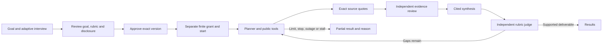

# Snowball

Snowball researches a user-approved goal. It proposes research tasks, searches and fetches public sources, checks exact quotations, obtains an independent evidence review, writes a cited deliverable, and asks a separate model to assess the locked rubric. A master's search is runtime input, not a built-in questionnaire or financial evaluator.

**Build status:** integration verification is in progress. Passing component tests and source reviews do not establish end-to-end completion. The current implementation plan is [the generic integration plan](docs/superpowers/plans/2026-10-15-snowball-generic-harness-plan.md); its acceptance authority is [the approved generic specification](docs/superpowers/specs/2026-10-10-snowball-generic-goal-harness-design.md). The earlier specialist design and its checklist remain historical files, not the active backlog.

## Workflow



The harness never applies to programs, purchases anything, sends outreach, fills forms, or exposes arbitrary shell tools. Installing it does not approve a goal or start personal research.

## Start the console

Python 3.10+ and the dependencies in `pyproject.toml` are required. Production public fetching uses `curl_cffi`; browser automation is not a fetch prerequisite.

```sh
python -m pip install -e .
python snowball.py goal --db data/snowball.db serve --port 8989 --origin http://127.0.0.1:8989
```

Open `http://127.0.0.1:8989/`. The server binds loopback only. An interactive terminal displays the one-use bootstrap token once. For a service/non-interactive launch, the CLI writes it to `state/bootstrap-token` with private permissions instead of logging its contents. An operator may supply `SNOWBALL_CONSOLE_BOOTSTRAP_TOKEN` through a protected environment file.

The authenticated console has five views: **Goal, Results, Activity, Evidence, Graph**. Graph is last. Goal contains the stored interview, recipient consent, editable proposal, reviewed-hash approval, grant, start and controls. Results and Evidence use persisted findings and exact excerpts; no demonstration rows populate an empty database.

Approval, grant, start and a bounded run are distinct actions. Pause prevents new admission and displays draining work. Revision retires the old execution and requires another reviewed approval, grant and start.

## Model and search configuration

The generic runtime sends explicit HTTP JSON requests. It does not inherit OMP/Claude CLI memory, extensions or conversation history and does not silently substitute models.

| Setting | Meaning |
| --- | --- |
| `SNOWBALL_MODEL_BASE_URL` | Operator-configured OpenAI-compatible base URL, ending in `/v1` |
| `SNOWBALL_MODEL_API_KEY` | Optional gateway credential; omitted means no Authorization header |
| `SNOWBALL_INTERVIEW_MODEL` | Adaptive question and proposal role |
| `SNOWBALL_PLANNER_MODEL` | Bounded criterion-targeted task planning |
| `SNOWBALL_RESEARCH_MODEL` | Source-backed claim proposals |
| `SNOWBALL_REVIEW_MODEL` | Independent evidence review; different model from planner/research |
| `SNOWBALL_SYNTHESIS_MODEL` | Proposed cited research deliverable |
| `SNOWBALL_JUDGE_MODEL` | Independent semantic rubric assessment; different model from planner/research |
| `SNOWBALL_MAX_OUTPUT_TOKENS` | Finite per-call output ceiling; default 4096 |
| `SNOWBALL_SEARCH_URL` | Optional trusted search-service endpoint; approved source seeds work without search |
| `SNOWBALL_SEARCH_API_KEY` | Optional credential for that search service only |

`config.oracle.env` contains the non-secret direct AGY role configuration. The gateway at Oracle loopback `http://127.0.0.1:8088/v1` is a cloud proxy, not local inference. Its observed exact model identifiers are `gemini-3.8-flash-high` and `claude-sonnet-4-6`. Credentials never belong in a contract or source file.

A reported model mismatch, truncated output, malformed JSON or unavailable role stops that semantic operation. Calls record requested/reported identity and usage as actual or unknown. Unknown usage consumes its conservative reservation; it is not a zero-token call or a provider invoice guarantee.

Before the first interview model call, approve the exact recipient, input references and finite interview allowance. Public recipients receive only authorized public material. Rewriting private text does not make it public. Research grants do not silently grant interview disclosure permission.

## CLI

Use `snowball.py goal --db PATH COMMAND`; `--db` also works after the command. JSON values and options come from files so private context need not enter shell history.

| Command | Purpose |
| --- | --- |
| `init --title TEXT [--goal-id ID]` | Create a code-rendered generic interview |
| `list`, `status [--goal-id ID]` | Read stored goals/state without creating or migrating a database |
| `answer --goal-id ID --question-id ID --value FILE --state STATE` | Store a typed confirmed, unknown, declined or unconfirmed answer |
| `consent --goal-id ID --recipient ID --refs FILE --recipients FILE --calls N --tokens N` | Authorize exact interview inputs and a finite allowance; recipient map is explicit |
| `interview --goal-id ID` | Ask adaptive follow-ups within that consent |
| `propose --goal-id ID --options FILE` | Propose the rubric/public brief and attach reviewed limits, seeds and recipient permissions |
| `approve --goal-id ID --payload FILE --body-hash HASH --row-version N` | Approve the exact reviewed immutable version; no execution |
| `grant --goal-id ID [--limits FILE]` | Allocate allowance within the approved absolute ceilings |
| `start --goal-id ID --grant-id N` | Make the separately granted goal runnable |
| `run --goal-id ID --max-waves N` | Execute a bounded autonomous research run |
| `pause`, `resume`, `stop`, `revise` with `--goal-id ID` | Explicit durable controls; revision never starts a replacement |
| `supervise [--goal-id ID] --max-waves N --poll-sec N` | Process already-running goals only; idle otherwise |
| `ask --goal-id ID QUERY` | Retrieve kept local evidence without a model call |
| `export --goal-id ID --out FILE` | Write a cited Markdown research deliverable |
| `diagnostics` | Read configuration/role availability without migration |
| `migrate --root ROOT [--backup-dir DIR]` | Explicit preserving generic-schema migration |
| `restore --bundle DIR --destination EMPTY_ROOT` | Restore the complete verified corpus into an isolated root |
| `retention --root DIR --keep N` | Retain owned backup bundles; never prune source/wiki history |

Inspect exact flags with `python snowball.py goal --db data/snowball.db COMMAND --help`. Mutations accept row-version CAS where applicable; a conflict requires review rather than blind retry. Errors are structured JSON with exit status 2.

## Evidence and resource rules

- Fetch only approved seeds or discovered public links. Public DNS/IP pinning, redirect revalidation, robots exclusions, terminal access walls and rate limits remain in force. Search and model credentials cannot follow redirects to another endpoint.
- Keep original source bytes and exact extracted text with hashes. A model proposes quotations; code verifies the literal source span. A matching quote alone does not create a kept verdict.
- Keep, dispute, reject or leave claims unknown through a separate reviewing model. Missing review remains unknown. Disputed/rejected/unknown material cannot support a positive verdict.
- Assess the actual requested deliverable against the exact authorized rubric. Missing private assessment, unsupported citations, conflicts or unknown required criteria prevent full rubric-met.
- Reserve expansion tasks, sources/bytes, model/tool calls and model usage before dispatch. Lifetime use survives grant replacement, restart, pause and revision. Record conservative lost usage for uncertain dispatched work.
- Workers perform external I/O without sharing SQLite connections. The owning thread settles operations and commits against the dispatched binding. A stale callback cannot qualify the current version.
- Working context has hard bounds and recipient filtering. Refresh selections at checkpoints and the configured researcher-turn cadence. Low-ranked evidence stays in the audit store even when it leaves working context.
- A `STOP` file or interrupt stops process work without rewriting the user's substantive goal. Unknown, empty frontier, outage, exhaustion and stall are not success.

## Migration and operator installation

New goals use the generic schema. Existing legacy/specialist rows remain historical and never become approved generic goals through migration. Read-only commands refuse incompatible schemas instead of migrating them.

Before migration, Snowball creates and verifies a bundle containing the SQLite database and referenced source/wiki bytes with SHA-256 checksums. Restore checks path confinement, symlinks/reparse points and checksums, stages a complete isolated corpus, and preserves logical wiki-relative identifiers. Keep the bundle outside a running corpus before operator cutover.

The checked-in dashboard/supervisor units target generic commands and `data/snowball.db`. They are installation templates, not evidence of deployment. Oracle's existing research unit remains disabled; this build does not start it. The existing tailnet-only Caddy site can forward to the loopback console. Do not bind the application to a public interface.

A personal research run still needs its actual approved goal, exact disclosure permissions and finite grant. Build verification uses synthetic goals and separately identified public model/tool scenarios, never an applicant profile.

## Verification

```sh
python -m unittest discover -s tests -p 'test_generic_*.py' -v
```

The generic tests cover durable controls, source/transport boundaries, privacy, model output failures, context bounds and integration scenarios. Actual browser, public-source/model and rollback scenarios must accompany the final integration evidence. Historical component review #11 is not a completion certificate for the integrated tool.
