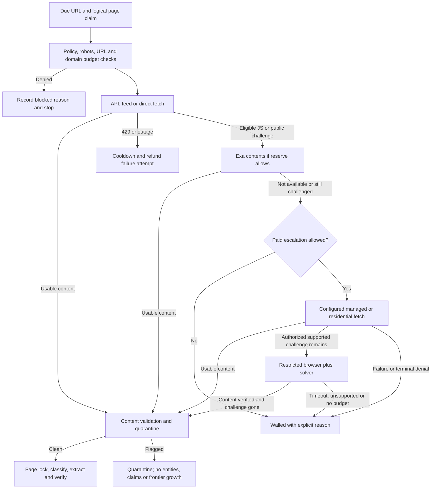

# Snowball Completion, Proxy Fetching, and CAPTCHA Support Implementation Plan

> **For agentic workers:** REQUIRED SUB-SKILL: Use superpowers:subagent-driven-development or superpowers:executing-plans to implement this plan task-by-task. Steps use checkbox syntax for tracking.

**Goal:** Finish the outstanding Fable requirements and ship an autonomous research pipeline with bounded proxy fetching and CAPTCHA handling for authorized public-page access, backed by live evidence.

**Architecture:** Keep the existing deterministic locks, SQLite store, source router, and model adapters. Add an explicit access policy, paid-request ledger, managed-fetch adapters, and a separate restricted browser worker. All retrieval routes feed the same content validation, quarantine, evidence, deduplication, compiler, and delivery pipeline.

**Tech Stack:** Python >=3.10; SQLite WAL/FTS5; existing curl_cffi and PyYAML; optional Playwright Chromium; ZenRows Universal Scraper API; 2Captcha API v2; systemd on goku; existing Oracle model and Exa endpoints.

**Spec:** `docs/SYSTEM_DESIGN.md`, especially sections 3–9, plus the access-policy amendment in section 1 of this plan. This plan intentionally changes I4, the CAPTCHA/bot-wall part of section 1.5, sections 4.5–4.6, and the no-browser operational assumptions. Unchanged requirements remain binding.

**Status:** Proposed implementation plan requested on 2026-10-08. No implementation, paid provider activation, or completion of acceptance gates is implied by this document.

## Global constraints

- Preserve code-generated queries, deterministic novelty decisions, tool-free models, private-topic isolation, and evidence-quote validation.
- Preserve the SSRF deny list: private, loopback, link-local, metadata, reserved addresses, and `100.64.0.0/10`; HTTP(S) ports 80/443 only for target pages.
- Public-page access does not authorize login bypass, paywall bypass, purchase/application actions, credential use, or circumventing explicit access denials or rate-limit bans. Robots exclusions remain final.
- Production state belongs on goku; Oracle supplies model/Exa services. Verify host facts again at deployment; historical free-memory/disk figures are not deployment evidence.
- Keep `MemoryMax=3G`, memory soft guard 2200 MB, free-disk floor 5 GB, body limit 5242880 bytes, collector concurrency 6, and per-domain rate 6/minute with burst 3.
- Preserve summary floor 0.70 plus number survival; staleness depth 1; dirty/stale compiler limits 200/50 pages and 600 seconds per run.
- Preserve task heartbeat 60 seconds, stale-task reaping 600 seconds, three failure strikes, three dry hops, and Exa reserve of three live keys.
- Keep the current multi-engine model selection. Verify usable model IDs and credentials rather than silently replacing the selected models. Never use a paid GPU alias just to make a smoke pass.
- Use integer micro-USD for spend, integer bytes for proxy traffic, and provider-specific units for audit. Do not add unlike credit units together or assume the old specification's price table is current.
- Follow the `_sibling()` import convention until a deliberate all-caller package cutover; do not place `tools/` on `sys.path` where `queue.py` shadows the standard library.
- Permanent tests cover consumer behavior, state transitions, race boundaries, and error handling. Remove tests that only re-pin wording, implementation details, or fake evaluator success.
- Each task includes a regression/smoke cycle and updates its affected docs. Execute tests once after each completed task, not while concurrent agents still edit shared code.

## 1. Revised access design

### 1.1 Policy amendment

Replace the blanket refusal to handle CAPTCHA or bot challenges with this requirement:

> Snowball may use configured managed fetching, residential proxies, and a CAPTCHA provider to retrieve authorized public research pages. Escalation is explicit, domain-scoped, cost-capped, and time-bounded. Login/paywall barriers, robots exclusions, explicit access denials, and rate-limit bans are terminal or cooldown conditions, not invitations to rotate identities.

Domain policy lives in `access.yml`: exact target origins, allowed path prefixes, allowed retrieval modes, approved challenge/resource origins, and whether challenge solving is authorized. Discovered pages cannot grant themselves access. Unknown domains retain the free public-fetch route; paid/browser/solver escalation requires operator configuration. This is one-time policy configuration, not a per-page approval queue.

CAPTCHA support covers standalone Turnstile, Turnstile challenge flows, and reCAPTCHA v2. Each requires a provider-backed live gate. Other challenge families are explicitly `unsupported_challenge`, not silently treated as solved. Managed-fetch success on other challenge families may yield ordinary public content, but does not constitute a native solver implementation for them.

A generic 401/403/407/451 without a recognized authorized public challenge is an access denial and stops escalation. A recognized challenge may itself arrive with HTTP 403; classify its body and configured policy before deciding whether solving is permitted. HTTP 429 always enters cooldown rather than paid identity rotation.

### 1.2 Approaches considered

| Approach | Benefit | Cost/risk | Decision |
|---|---|---|---|
| Managed fetching only | Smallest runtime; rendering/proxy offload | Provider dependency; limited control of challenge session and provenance | Include as preferred escalation |
| Local browser first | Full DOM/session visibility | High memory, broader attack surface, browser cleanup and network isolation | Reject as the default |
| Hybrid, cheapest first | Free retrieval stays cheap; managed path handles common cases; solver remains bounded | More state to account for and verify | Selected |

### 1.3 Retrieval state machine



The diagram shows logical transitions, not permission to submit multiple unbounded paid attempts. Each acquisition has at most two billed retrieval operations total, one solver task, and one browser context. A managed API call is one operation; a residential acquisition is one operation with a reserved byte ceiling, including all browser subresources. Record subresource requests separately rather than charging each as a new acquisition. The policy chooses managed fetching or standalone residential fetching before spending; it does not try every provider in sequence. Solver work consumes its own reservation within the same overall spend ceilings.

### 1.4 Starter limits and secrets

| Setting | Proposed canary value | Meaning |
|---|---|---|
| `ACCESS_MODE` | `auto` | Implement all routes; paid execution also requires domain policy and nonzero caps |
| `MAX_PAID_FETCHES_PER_DAY` | 100 | Billed retrieval operations, including residential acquisitions |
| `MAX_CAPTCHA_SOLVES_PER_DAY` | 10 | Submitted tasks, including unresolved submissions |
| `PAID_DAILY_BUDGET_MICRO_USD` | 5000000 | USD 5 combined daily ceiling, midnight IST |
| `PAID_MONTHLY_BUDGET_MICRO_USD` | 50000000 | USD 50 combined calendar-month ceiling, IST |
| `PAID_FETCH_MIN_YIELD_SCORE` | 0.30 | Existing Fable yield requirement |
| `MAX_PAID_RETRIEVALS_PER_ACQUISITION` | 2 | Prevent provider escalation loops |
| `MAX_SOLVES_PER_ACQUISITION` | 1 | Prevent repeat CAPTCHA purchases |
| `MAX_PROXY_BYTES_PER_ACQUISITION` | 20971520 | 20 MiB total proxy traffic, including browser/challenge resources |
| `BROWSER_CONCURRENCY` | 1 | Isolated challenge worker |
| `BROWSER_WORKER_MEMORY_MB` | 768 | Sub-limit inside total production memory budget |
| `ACCESS_DEADLINE_SEC` | 240 | Entire escalation lifecycle |
| `CAPTCHA_DEADLINE_SEC` | 120 | Within the access deadline, not an additional allowance |
| `CAPTCHA_POLL_SEC` | 5 | Respect documented provider polling minimum |
| `SESSION_TTL_SEC` | 600 | No cookie/session retention beyond the acquisition window |

These are proposed operating limits, not observed provider prices or permission to spend during planning. Shipped secret-free configuration keeps paid ceilings at zero; deployment sets the agreed canary limits after real credentials, tariff ceilings, and approved domains exist.

Use IST submission windows for count/spend accounting. Unresolved reservations survive day/month rollover and conservatively reduce currently available paid budget until provider reconciliation resolves them. Midnight must not turn an unknown charge into free budget.

Secrets: `ZENROWS_API_KEY`, `RESIDENTIAL_PROXY_URL`, `CAPTCHA_API_KEY`, and existing model credentials. Never log API-key query parameters, proxy credentials, challenge tokens, or cookies. Store only redacted provider/account/session references. Private topics never use external paid fetchers or solvers.

### 1.5 Provider lifecycle and safety

- ZenRows: `GET https://api.zenrows.com/v1/`, public target `url`, API key, `original_status=true`; opt into `js_render` and `premium_proxy` only for the chosen mode. Its returned body is content, not automatically a JSON object with a `content` field. Reclassify the target response and challenge body, not just the provider's HTTP 200.
- ZenRows `session_id` preserves egress IP for ten minutes; it does not preserve cookies. A separate context owns the cookie jar. Do not assume a managed-provider session can also be used by a local browser or solver.
- Residential route: one scoped curl_cffi session with explicit proxy settings and `trust_env=False`. Preserve a stable session through a challenge workflow. Never switch IP mid-solve or rotate on a rate-limit/access ban.
- Solver: API v2 `createTask` returns `taskId`; persist it before polling `getTaskResult`. Poll no faster than every five seconds. A ready token is not retrieval success: the approved page flow must accept it and reveal usable research content.
- For IP-bound flows, the browser and solver must use compatible matching egress and user-agent state. If a provider cannot supply that continuity, that combination is not eligible; do not submit a task destined to fail.
- A create-task timeout can leave paid work running. Mark submission `unknown`; hold its reservation; do not blindly resubmit. Reconcile known task IDs after worker loss. Do not claim timeout cancels or refunds work without a documented provider guarantee.
- Browser: one fresh context per acquisition; no desktop profile, extensions, login state, arbitrary page-directed actions, or LLM-controlled JavaScript. Allow only the code-defined challenge callback/response flow, never application/payment/account forms. Destroy session cookies and tokens when the acquisition ends.
- URL validation alone is not browser SSRF isolation. Playwright request routing does not reliably intercept every redirect hop; service workers and alternate channels add risk. The browser worker runs in a restricted network namespace on goku and can connect only to its enforcing egress gateway. The gateway validates each HTTP target or CONNECT destination, resolves and pins public addresses, rejects private/tailnet ranges, and either connects directly or uses an approved upstream proxy that supports tunnelling to that validated destination. Disable browser DNS/UDP/direct egress; strip proxy credentials before forwarding. Prove redirect-to-private, DNS rebinding, WebSocket, and direct-network escape are blocked. An upstream proxy that overrides destination enforcement is not eligible for this worker.
- Local direct fetching keeps DNS pinning. Remote providers resolve targets themselves: do not claim local pinning covers remote fetches. Paid remote retrieval is exact-origin/path allowlisted, excludes operator credentials, and requires verified provider private-destination/redirect restrictions. If a backend cannot establish that contract, leave it disabled for arbitrary discovered URLs and record the limitation.
- Browser challenge origins receive a separate exact allowlist. A scraped resource link cannot expand it. Block downloads, popups, service workers, and unnecessary media; preserve resources needed for supported challenges.
- Browser contexts do not hold SQLite transactions open or block free collectors while waiting for the solver. Separate workers exchange bounded data through code-owned messages, not browser access to the research database.

## 2. Baseline evidence and honest status

Observed on 2026-10-08, not a claim about future deployment:

- Live isolated AWS/Google cloud-credit run fetched two official pages with HTTP 200. Google yielded one verified entity and three committed claims; AWS extraction received Gemini 503 and remained pending.
- The entity link was null; source linkage needs a deterministic fix. X search failed in Windows cleanup at `os.killpg`.
- Oracle and goku had no installed Snowball user units. Oracle had no Snowball `.env`; configured adapter 8812 was unreachable. A separate model proxy listened on 8800, but Snowball credentials did not authorize it.
- The digest service passes unsupported `--daily`. Digest compilation sets `reported_at` before any send. The digest evaluator passed with 0/0 quotes.
- `tests/test_fable_gates.py` has 14 methods, not executions of all 44 gates. Some checks do not exercise the production path.
- Paid fetching, hub diffing, refill, drift enforcement, incremental dirty/stale compilation, retention/backups, feedback ingestion, and urgent alerts require implementation or wiring.
- The inherited `tools/forum.py` Camoufox fallback exists outside the active orchestrator. Retire that unbounded alternate path after the new access worker works; do not leave two policies active.

## 3. File ownership and shared contracts

Prefer extending existing files. Split only the new access/process concerns out of the already-large orchestrator.

| File | Planned responsibility |
|---|---|
| `tools/orchestrator.py` | Store migrations, code-generated frontier, wave coordination, lock engine, and integration with new modules |
| `tools/fetch_types.py` | Move existing `FetchResult`/`SearchHit` here after references/callers are mapped; shared acquisition metadata, no compatibility re-exports |
| `tools/process_control.py` | Owned child-process lifecycle on Linux and Windows |
| `tools/access_policy.py` | Parse `access.yml`; approved origins/paths/modes; terminal barrier decisions |
| `tools/paid_budget.py` | Atomic reservations, ceilings, settlement, and unresolved charge accounting |
| `tools/paid_fetch.py` | Concrete ZenRows and residential adapters; no generic plugin framework |
| `tools/egress_guard.py` | Enforce validated browser/proxy connection destinations and deny direct escape |
| `tools/browser_worker.py` | Bounded isolated browser acquisition and challenge adapters |
| `tools/captcha.py` | 2Captcha task submission/polling/result lifecycle |
| `tools/wiki_compiler.py` | Deterministic entity/topic/hub pages; summary merge, dirty/stale cache, reindex |
| `tools/digest.py`, `tools/alerts.py` | Durable delivery selection, Discord acknowledgements, one-time urgent alerts |
| `tools/ask.py`, `tools/eval_gates.py` | Library answers and truthful evaluators against production functions |
| `tools/retention.py`, `tools/feedback.py` | Retention/backup/integrity; optional feedback and weekly briefing |
| `snowball.py` | Complete CLI, including `run-once`, retention, access diagnostics, and eval time windows |
| `config.env`, `access.example.yml`, `pyproject.toml` | Non-secret settings, exact policy example, optional browser dependency |
| `systemd/` | Supervisor, digest, retention, browser/egress worker, and LLM/Exa tunnel units |

Proposed interfaces, implemented by the named tasks rather than presumed to exist now:

```python
# tools/access_policy.py, task T2
load_access_policy(path: Path) -> AccessPolicy
AccessPolicy.decide(url: str, private: bool, wall_kind: str | None) -> AccessDecision
# decision fields: allowed_modes, denial_reason, approved_resource_origins

# tools/paid_budget.py, task T2
reserve(store: Store, acquisition_id: str, provider: str, max_cost_micro_usd: int) -> Reservation
settle(store: Store, reservation_id: int, actual_cost_micro_usd: int | None, outcome: str) -> None
# None actual cost retains worst-case reservation; never implies a refund.

# tools/paid_fetch.py, task T3
fetch_managed(request: AccessRequest, cfg: Config, reservation: Reservation) -> FetchResult
fetch_residential(request: AccessRequest, cfg: Config, reservation: Reservation) -> FetchResult

# tools/captcha.py, task T4
submit(challenge: Challenge, cfg: Config, reservation: Reservation) -> SolverTask
poll(task: SolverTask, deadline_at: float) -> SolveResult
# task/solution contain no serializable secret fields in repr/log output.

# tools/browser_worker.py, task T4
acquire(request: AccessRequest, cfg: Config, deadline_at: float) -> FetchResult

# tools/process_control.py, task T1
stop_owned_process_tree(proc: subprocess.Popen, grace_seconds: float = 5.0) -> None

# tools/wiki_compiler.py, task T8
compile_wiki(conn: sqlite3.Connection, output_dir: Path, full: bool = False) -> dict[str, int]
reindex_wiki(conn: sqlite3.Connection, wiki_dir: Path) -> dict[str, int]

# tools/digest.py, task T9
prepare_digest(conn: sqlite3.Connection, day: str) -> list[PreparedDigest]
send_digest(prepared: PreparedDigest, channel_id: str) -> DeliveryAck
acknowledge_digest(conn: sqlite3.Connection, prepared: PreparedDigest, ack: DeliveryAck) -> None
# ack has message_id; only acknowledge mutates reported_at.
```

Keep exact data contracts small:

| Type | Owner | Required fields |
|---|---|---|
| `AccessRequest` | `tools/fetch_types.py` | `acquisition_id: str`, `page_id: int`, `url: str`, `private: bool`, `allowed_modes: tuple[str, ...]`, `approved_resource_origins: tuple[str, ...]`, `allowed_path_prefixes: tuple[str, ...]`, `session_id: str`, `deadline_at: float` |
| `AccessDecision` | `tools/access_policy.py` | `allowed_modes: tuple[str, ...]`, `denial_reason: str | None`, `approved_resource_origins: tuple[str, ...]`, `allowed_path_prefixes: tuple[str, ...]` |
| `Reservation` | `tools/paid_budget.py` | `id: int`, `acquisition_id: str`, `provider: str`, `max_cost_micro_usd: int`, `state: str`; define `PaidBudgetExhausted` here |
| `Challenge` | `tools/captcha.py` | `kind: str`, `url: str`, `sitekey: str`, `session_id: str`, `proxy_ref: str | None`, `user_agent: str`, `action: str | None`, `data: str | None`, `pagedata: str | None`; challenge data excluded from repr/logging |
| `SolverTask` | `tools/captcha.py` | `provider: str`, `task_id: int | None`, `reservation_id: int`, `submission_state: str` |
| `SolveResult` | `tools/captcha.py` | `status: str`, `token: str | None`, `user_agent: str | None`, `cost_micro_usd: int | None`; token excluded from repr/logging |
| `PreparedDigest` | `tools/digest.py` | `delivery_key: str`, `day: str`, `item_refs: tuple[tuple[str, str], ...]`, `text: str`, `chunk_index: int`; one prepared record per bounded Discord message |
| `DeliveryAck` | `tools/digest.py` | `delivery_key: str`, `channel_id: str`, `message_id: str`, `sent_at: int` |

`prepare_digest` returns message-sized records; send and acknowledge each record before sending the next. The outbox preserves acknowledged chunks if a later chunk fails. All retrievals return the same usable-content/challenge/outage/failure classification. No compatibility exports remain after the shared-type cutover.

## 4. Tasks and review boundaries

### T0: Reconcile specification and gate evidence

**Files:** modify `docs/SYSTEM_DESIGN.md`, `docs/PLAN.md`, `README.md`, `tests/test_fable_gates.py`, `tools/eval_gates.py`.
**Consumes:** this plan and the original 44 gates. **Produces:** one current policy and `data/gate-evidence.jsonl` entries with `gate_id`, `status`, `command`, `exit_code`, `started_at`, `finished_at`, and redacted `evidence_path`. States are `implemented`, `fixture_verified`, `live_verified`, `soak_verified`, and `blocked`; only evidence permits a verified state.

- [ ] Amend I4 and the cited policy/architecture sections; keep public-source, evidence, privacy, no-action, and access-denial restrictions. Clearly distinguish feature implementation from provider activation.
- [ ] Replace the inaccurate 44-gate test-suite claim. Identify the evaluator/production mismatch and record T5/T9/T10 as its implementation owners; do not make T0 depend on classifier/delivery code that has not shipped.
- [ ] Remove tests that pass by checking wording, six slug examples instead of the property gate, an empty reindex, or quote length as verification. Keep real behavior regressions.
- [ ] Record the already-observed 0/0 digest pass and premature delivery acknowledgement as T9/T10 regression inputs. Update affected docs and open a reviewable PR from a real feature branch. This task changes specification/status records, not runtime behavior.

**Acceptance:** no remaining statement equates a green unit suite or existing tag with all Fable gates complete.

### T1: Fix the observed live-run failures

**Files:** modify `tools/orchestrator.py` model/Grok lifecycle and entity writing; create `tools/process_control.py`; extend `tests/test_orchestrator.py` and `tests/test_e2e_full.py`; update `config.env`.
**Consumes:** existing model adapters and Store. **Produces:** cross-platform owned-process cleanup and source-backed entity links.

- [ ] Reproduce the Windows Grok cleanup bug with an owned child/grandchild fixture. Linux uses the launched process group; Windows uses an owned Job Object with kill-on-close. Do not kill processes by global executable name.
- [ ] Guarantee cleanup on output, timeout, parse failure, cancellation, and exception. Preserve fetched X JSON if cleanup succeeds; validate post IDs/dates before ingestion. Reaper cleanup must not affect unrelated Grok sessions.
- [ ] Implement a provider diagnostic that performs authenticated availability checks and a bounded completion. Resolve actual endpoints and configured model IDs from tools/host configuration. Missing credentials/model errors are explicit blockers, not `ok` based on key presence.
- [ ] Attach the fetched evidence-page URL when the extracted entity omits a link; use an explicitly extracted official/apply URL only after verifying it came from the fetched source. Do not fabricate a URL or claim the evidence URL is an application endpoint.
- [ ] Repeat the real AWS/Google public-topic smoke under current configured engines, with network limits and durable evidence. Verify source quote, entity source URL, outage deferral, and zero orphan processes.

**Regression example:**
```python
self.assertEqual(entity['evidence_page_id'], fetched_page_id)
self.assertEqual(entity['link'], fetched_page_url)
self.assertEqual(remaining_owned_children, [])
```

### T2: Implement policy, schema migrations, and paid-budget reservations

**Files:** modify `tools/orchestrator.py` Config/Store, `config.env`, `snowball.py`; create `tools/fetch_types.py`, `tools/access_policy.py`, `tools/paid_budget.py`, `access.example.yml`, `tests/test_access_budget.py`.
**Consumes:** T0 policy and Store transactions. **Produces:** shared request/result types, access decisions, and atomic spend reservations.

- [ ] Map exported type/function references before moving `FetchResult`/`SearchHit`; migrate every caller and remove old exports. Extend route/outcome CHECK constraints by a transactional, versioned table migration preserving FK/index data.
- [ ] Add `access_attempts` linked to one logical `fetches` acquisition; extend `paid_fetches` for reservation state, worst-case/actual micro-USD, provider task reference, and outcome. Record every network/provider sub-attempt; do not hide them by coalescing logical fetches.
- [ ] Reserve maximum billable spend under `BEGIN IMMEDIATE` before a provider call. Account for settled charges plus outstanding/unknown reservations against daily/monthly combined caps, retrieval count, solver count, and provider-specific units.
- [ ] Preserve reservations across crash/ambiguous submission. Release only on provider-confirmed nonbillable failure; settle known actual costs exactly. Missing tariffs/balance disable the relevant paid route.
- [ ] Deny private topics, unauthorized origins, path escapes, robots exclusions, and login/paywall/ban states before submitting a billable request. Config changes invalidate policy/session caches.
- [ ] Prove the fourth reservation fails when the configured count cap is three, and concurrent workers cannot overspend. Prove a crash/unknown charge does not reopen the same budget.

**Regression example:**
```python
for _ in range(3):
    reserve(store, next_acquisition(), 'zenrows', 100000)
with self.assertRaises(PaidBudgetExhausted):
    reserve(store, next_acquisition(), 'zenrows', 100000)
```

### T3: Ship managed and residential retrieval with common safety checks

**Files:** create `tools/paid_fetch.py`, `tools/egress_guard.py`, `tests/test_access_fetch.py`; modify `tools/orchestrator.py` FetchRouter and result recording; extend `config.env`.
**Consumes:** T1 source/provenance rules and T2 decisions/reservations. **Produces:** working paid routes and enforcing connection policy for T4.

- [ ] Implement direct/API/feed -> Exa contents -> the configured paid route. Implement real Exa `/contents` lookup for queued URLs without search-prefilled text, respecting reserve and robots. No silent paid fallback for 429/ban/access denial.
- [ ] Add ZenRows basic/rendered modes and explicit residential curl_cffi proxy configuration. Disable environment-proxy inheritance; keep cookies/auth scoped, TLS verification on, body/deadline limits enforced, and provider error URLs redacted.
- [ ] Distinguish provider errors from target status, challenge HTML, login/paywall content, truncated/oversized bodies, and usable content. Unknown provenance is not a verified source.
- [ ] Implement browser egress enforcement; verify how each remote backend controls private destinations and redirect chains. Fail closed for unsupported backend safety contracts; do not weaken direct SSRF just because a proxy is enabled.
- [ ] Test challenge-as-200, malicious redirect, DNS rebinding, cookie isolation, credentials in error strings, timeout charges, and byte/count/spend caps. Browser/private endpoint canaries must show no target connection.
- [ ] Run five real managed-fetch requests and a residential IP echo/read-only canary under an explicit approved cap. Record selected modes, content hashes, target statuses, bytes, ledger reservations/settlements, and provider usage reconciliation. A key missing is `blocked`, not a fake pass.

**Acceptance:** both adapters retrieve real approved public content; no TLS-disable or SSRF bypass switch; no paid call for ineligible low-yield articles or blocked access.

### T4: Ship the bounded browser and CAPTCHA-provider path

**Files:** create `tools/browser_worker.py`, `tools/captcha.py`, `tests/test_challenge_lifecycle.py`, `systemd/snowball-browser.service`, `systemd/snowball-egress.service`; modify `pyproject.toml`, `tools/orchestrator.py`, `tools/forum.py`, `prompts/research.md`.
**Consumes:** T2 limits/task ledger and T3 egress guard. **Produces:** real Turnstile/reCAPTCHA-v2 challenge handling with verified post-challenge content.

- [ ] Add optional Playwright dependency and install its matching Chromium on the production host. Launch a separate worker with one context, memory/deadline limits, restricted filesystem, enforcing egress, no DB handle, no stored desktop/auth state, and deterministic teardown.
- [ ] Implement supported challenge adapters from provider contracts. Capture only required public challenge metadata, not full private page contents. Keep target URL/sitekey/session bound to the same acquisition. No LLM-driven browser actions.
- [ ] Submit one 2Captcha task; persist `taskId`, poll at >=5-second intervals, enforce the overall deadline, and record provider-reported cost. Handle insufficient balance, unsupported/missing parameters, unsolvable responses, token expiry, session mismatch, and ambiguous submission without blind resubmission.
- [ ] Apply a ready solution only to the authorized challenge flow in the same browser context. Validate challenge disappearance and actual source text before returning `ok`; never accept a solver token as proof of access.
- [ ] Prove a hanging solver/browser cannot block free collectors, leak children/cookies/tokens, duplicate a billable task after restart, or exceed the browser-memory budget. Check memory with a real browser, not a mock.
- [ ] Run owned/provider demo gates for standalone Turnstile, challenge-page Turnstile, and reCAPTCHA v2. Record real task IDs and acceptance outcome in a restricted evidence artifact; redact secrets/tokens in normal logs. Missing owner-controlled challenge-page fixture is a named prerequisite, not inferred support.
- [ ] After all supported challenge gates pass, remove inherited Camoufox fallback and its prompt instructions. Make tools/forum.py use the same access policy or limit it to free API/direct routes; no second bypass policy survives.

**Regression example:**
```python
self.assertEqual(submitted_solver_tasks_for_acquisition, 1)
self.assertEqual(content_outcome_with_token_but_challenge_present, 'walled')
self.assertEqual(active_owned_browser_children_after_deadline, [])
```

### T5: Finish production classification, seed grid, and hub diffs

**Files:** modify `tools/orchestrator.py` seeding, classification, fetch recording, and page/hub scheduling; `tools/eval_gates.py`; `topics.example.yml`; extend `tests/test_orchestrator.py` and labelled fixtures.
**Consumes:** the common retrieval result from T1/T3/T4. **Produces:** code-generated query grid and row-level hub changes without repeat extraction.

- [ ] Generate family x region x audience x source x window queries deterministically; seed only configuration deltas. Make `seed --dry-run` read-only, stable, and representative of the actual query grid.
- [ ] Put the runtime classifier, not an unrelated evaluator heuristic, on the fetch pipeline; ambiguous pages use bounded classification, clean hubs use code-defined row extraction.
- [ ] Diff `hub_rows` by normalized row URL/text; 20->22 rows queues exactly two new pages and halves interval. Unchanged hub doubles interval and uses zero extraction tokens.
- [ ] Skip extraction for aliases/reprints/unchanged pages; process their genuinely new hyperlinks only. Persist source identity without counting syndication as independent corroboration.
- [ ] Run classifier on 50 labelled pages; extraction on 20 real pipeline fixtures; names-absent test; changed and unchanged hub transitions; 10,000 deterministic seeded slug-property cases.

**Regression example:**
```python
self.assertEqual(new_hub_urls, expected_two_urls)
self.assertEqual(tokens_after_unchanged_hub, tokens_before_unchanged_hub)
```

### T6: Finish claim/topic locks, drift guard, and frontier refill

**Files:** modify `tools/orchestrator.py` LockEngine, discovery/refill, and family relevance; `tools/eval_gates.py`; extend `tests/test_orchestrator.py` and add `tests/topic_pairs_30.jsonl`.
**Consumes:** T5 row/name outputs and existing FTS5/TF-IDF/MinHash. **Produces:** bounded source-derived exploration and calibrated deduplication.

- [ ] Verify five paraphrases/five independent domains yield one claim, five sources, and four variants. Exclude reprints from independent counts; preserve numeric differences as material facts.
- [ ] Benchmark 30 labelled topic pairs at existing 0.75/0.30 thresholds; meet >=95% new/not-new and >=80% same/deepen agreement. No embeddings dependency unless it beats the baseline.
- [ ] Enforce family relevance floor before frontier expansion. An off-topic page becomes dropped and cannot re-enter through a different discovered link in the same policy/window.
- [ ] Execute each unknown name's one source-derived search and consume deepen tasks. Fill a dry frontier from high-yield hubs using real Exa findSimilar/backlink results under reserve/budget; otherwise log 1800-second sleep.
- [ ] Prove a productive branch reaches depth 50 while a dry branch cuts at three; second same-topic run uses <=30% of first Exa calls without hiding due rechecks.

### T7: Complete supervisor, budgets, and crash ownership

**Files:** modify `tools/orchestrator.py` task claiming, heartbeat/reaper, finish/commit, global scheduling and run lifecycle; `loop.sh`, `snowball.py`; extend `tests/test_e2e_full.py`.
**Consumes:** T1 child cleanup and existing task ownership. **Produces:** resumable waves without stale-worker writes or repeated paid submissions.

- [ ] Heartbeat active tasks every 60 seconds and reap after 600. Increment/invalidate occurrence sequence at reclamation; state/row writes must check current claim and sequence in the same transaction, not only the final task acknowledgement.
- [ ] Replay pending/paused work after cooldown; do not leave failed initial queries locked forever. Resume extraction from fetched raw content rather than fetching again.
- [ ] Enforce global due scoring and per-domain limits while permitting asynchronous solver waits. LLM budget exhaustion keeps collection/hub diffs active and performs deterministic compilation; resource caps pause and resume rather than aborting the service.
- [ ] Replace stale legacy-log inspection in loop.sh with supervisor outcomes; implement `run-once`, stopped, dry-frontier, budget-sleep, and outage statuses with predictable exit behavior.
- [ ] Kill an owned worker mid-wave and restart the real supervisor. Check stale commits affect zero rows, no duplicate entity/source/claim, due=0 fetch count stays zero, and the paid ledger stays conservative.

**Regression example:**
```python
self.assertFalse(commit_with_reclaimed_occurrence(old_sequence))
self.assertEqual(store.one('SELECT COUNT(*) n FROM fetches WHERE due=0')['n'], 0)
```

### T8: Finish incremental Markdown compiler and cache rebuild

**Files:** modify `tools/wiki_compiler.py`, `tools/orchestrator.py` writer/dirty marking, `tools/eval_gates.py` reindex, `snowball.py`; extend `tests/test_e2e_full.py` and compiler behavior tests.
**Consumes:** committed verified facts/changes from T5/T6/T7. **Produces:** authoritative entity/topic/hub Markdown and complete rebuildable wiki caches.

- [ ] Use stable entity-key filenames including year; generate required frontmatter and code-owned Facts, Changes, Sources sections. Generate topic/hub pages and family/topic index. Preserve human-owned text outside explicitly generated sections.
- [ ] Merge only Summary through the configured local model when available; enforce 70% length floor and survival of old numbers. Preserve sorted-union aliases/sources/tags; deterministic sections always come from current verified data.
- [ ] Mark changed origins dirty and direct linkers stale once. A stale recompile never propagates. Process 200 dirty then 50 stale pages under 600 seconds, leaving unfinished rows dirty/stale.
- [ ] Commit successful file writes atomically before clearing dirty flags. Rebuild wiki_pages, wiki_links, wiki_fts from Markdown including human edits; no swallowed cache-insert errors.
- [ ] Verify A/B/C/D one-hop propagation, number survival, merge idempotence, 500-page budget, and 10,000-page reindex in <60 seconds on goku. Wire compile after the wave and retire the npm compiler/callers/dependency after cutover.

### T9: Fix digest acknowledgement and implement urgent alerts

**Files:** modify `tools/digest.py`, `tools/orchestrator.py` post-wave scheduling, `snowball.py`, `systemd/snowball-digest.service`; create `tools/alerts.py`; extend delivery behavior tests.
**Consumes:** T8 wiki/source state and verified entity changes. **Produces:** real report-once delivery, durable message IDs, and once-only urgent alerts.

- [ ] Replace compile-time acknowledgement with prepare/send/acknowledge. Persist selected item IDs in `digest_outbox` with stable `delivery_key`, `day`, `chunk_index`, `item_refs`, `text`, `state`, `message_id`, and `sent_at`; rank new items by relevance*(1+urgency), changes by relevance*1.2, maximum 25; exclude empty/unverified evidence.
- [ ] Split Discord messages at valid limits without cutting a quote/link/item. Map each delivery/message ID to exactly the items it carried. File-only mode never pretends Discord acknowledgement occurred.
- [ ] Set reported_at only after a response with a message ID, in a transaction protecting uniqueness and exact selected rows. Failed/ambiguous POSTs remain unacknowledged and reconcile before resend; use documented REST deduplication semantics where available, not an unsupported exactly-once claim across HTTP/SQLite.
- [ ] Implement deadline<=7 days, relevance>=0.5, alerted_at-null alerts after the wave. Once-only state follows confirmed delivery. Validate source link; use a verified hub fallback for dead links, marking link_dead.
- [ ] Fix the service/CLI argument contract. Read the existing bridge token from its configured source without copying credentials into tracked files.
- [ ] Run failure-then-success delivery against an owned test channel; store real message IDs; run a second digest and prove zero repeated sends. Prove a five-day deadline sends exactly one alert.

**Regression example:**
```python
prepared = prepare_digest(conn, day)[0]
self.assertIsNone(conn.execute("SELECT reported_at FROM entities WHERE key=?", (entity_key,)).fetchone()[0])
with self.assertRaises(DeliveryFailure):
    send_digest(prepared, failing_owned_transport_channel)
self.assertIsNone(conn.execute("SELECT reported_at FROM entities WHERE key=?", (entity_key,)).fetchone()[0])
acknowledge_digest(conn, prepared, confirmed_message_ack)
self.assertEqual(conn.execute("SELECT message_id FROM digest_items WHERE ref_id=?", (entity_key,)).fetchone()[0],
                 confirmed_message_ack.message_id)
```

### T10: Complete cited library answers and truthful evaluators

**Files:** modify `tools/ask.py`, `tools/eval_gates.py`, `snowball.py`; extend answer/evaluation tests.
**Consumes:** T8 wiki caches and T9 delivery records. **Produces:** grounded answers and measurable acceptance commands.

- [ ] Query wiki_fts with sanitized MATCH, top 12 BM25 pages, up to 25 filtered chunks; use the configured local answer model, not hardcoded public Gemini. No external call for private-library content.
- [ ] Require a valid retrieved [path] on every emitted factual sentence. Code drops unsupported citations/sentences, returns honest insufficient-evidence results, and does not replace missing evidence with model memory.
- [ ] Extraction evaluation runs the production extractor/schema/quote checks. Digest evaluation joins delivered lines to recorded source text and verifies live link or verified fallback. Zero rows are insufficient evidence, not PASS.
- [ ] Expose topic, extraction, digest, retention, access, and status diagnostics with machine-readable results and nonzero failure exits. Test malformed FTS queries, mixed grounded/ungrounded sentences, source edits/reindex, and a false long quote.
- [ ] Run the December-grants question on real compiled pages in <30 seconds, and seven-day digest audit with a nonempty delivered sample.

### T11: Deploy retention, backups, and restricted services on goku

**Files:** create `tools/retention.py`, `systemd/snowball-supervisor.service`, `systemd/snowball-retention.service`, `systemd/snowball-retention.timer`, `systemd/snowball-llm-tunnel.service`; modify existing digest timer/service and README/CLI.
**Consumes:** T7 supervisor, T8 compiler, T9 delivery, T4 optional browser/egress services. **Produces:** running production deployment with restore evidence.

- [ ] Prune raw at 14 days, quarantined raw at 30, logs at 30; preserve wiki/DB/digests. Create nightly consistent SQLite backup, retain seven copies, expire deadlines, and run weekly quick_check.
- [ ] Verify model and Exa authenticated endpoints, dependency wheels, browser binaries, ports, writable state directories, free disk and memory on actual goku. Choose the adapter or direct-model tunnel according to T1 diagnostics; never retain the known dead 8812 mapping without fixing it.
- [ ] Install/enable supervisor and digest/retention/tunnel units with working argument contracts; add browser/egress units only when policy and gates permit. Preserve STOP, restart, and no exposed public management port.
- [ ] Restore a backup into a separate directory and query entity/source/frontier state, then perform an isolated wave. Simulate eight backup dates to test retention, and retain eight-night live evidence as a separate soak requirement.
- [ ] Run 24-hour crash-free soak and seven/eight-day retention/repeat/digest measurements. Never infer these time-based gates from unit tests or a newly started service.

### T12: Finish optional feedback and weekly learning summary

**Files:** create `tools/feedback.py`; modify `tools/digest.py`, `tools/orchestrator.py` scoring, CLI and digest timer scheduling; extend feedback tests.
**Consumes:** T9 item/message IDs and T6 yield/drift decisions. **Produces:** source/domain feedback and a nonrepeating weekly briefing.

- [ ] Map authorized channel reactions to exact digest items. Deduplicate reaction events, update feedback_score, and show its effect on the next frontier value.
- [ ] Negative feedback changes prioritization only; it does not bypass policy, erase facts, or drop pages by itself. Handle removed/reversed reactions deterministically.
- [ ] Build weekly summary from verified new/materially changed knowledge in that week, with source links and delivery acknowledgement. Do not re-send the recent-claims list as daily new knowledge.
- [ ] Verify one downvote lowers next-wave priority without changing page eligibility/status; replaying the event changes nothing. Deliver a real weekly test briefing once.

### T13: Execute release gates and integrate through real PRs

**Files:** update `tests/test_fable_gates.py`, `.github/workflows/ci.yml`, runtime evidence ledger and affected docs.
**Consumes:** completed task outputs, not verbal subagent success. **Produces:** release evidence and reviewed integration.

- [ ] Use named feature branches/isolated worktrees and PRs per independently reviewable slice. Do not push development directly to main and substitute a release tag for a requested PR.
- [ ] Preserve offline deterministic unit/contract suite. Put real paid/network/browser gates behind explicit live execution flags and credentials; skipped gates stay blocked/unverified. Never put secret/customer-page contents in external review jobs.
- [ ] Run the actual program on at least three public topics: startup cloud credits, open-source grants, and developer fellowships. Seed known-source smoke separately from autonomous discovery. At least one topic must prove source discovery -> verified entities -> wiki -> cited answer -> Discord acknowledgement, then a second run without duplicate work/reporting.
- [ ] Run access gates A01–A15 below, all unchanged Fable gates, kill/restart, 24-hour soak, and seven/eight-day measurements. Save redacted commands, exit codes, timestamps, source URLs/content hashes, output rows, message IDs, and provider-cost reconciliation.
- [ ] Request code/security review, then Greptile/CodeRabbit where available. A missing review integration is a named blocked review gate, not proof of approval. Merge only approved green slices; create a new release after the evidence ledger satisfies the release criteria, without moving/deleting the existing v1.0.0 tag.

## 5. Dependencies and parallel ownership

- T0 precedes implementation; T1 and T2 can run independently afterward. One integration owner owns changes to orchestrator.py, Config, DDL, and shared result types.
- T3 requires T2; T4 requires T2/T3 egress and T1 child cleanup. Browser/solver support is not complete after only a successful mocked provider call.
- T5/T6 can proceed after T1 under the existing free-fetch path; T6 consumes T5 hub/name contracts.
- T7 incorporates T1 and T2 ownership/accounting; T8 consumes the settled writer contracts from T5–T7; T9/T10 consume T8.
- T11 requires working supervisor/compiler/delivery plus whichever access modes will be enabled. T12 requires T9 message IDs. T13 collects all evidence.
- Fan out only independent files/slices with fixed contracts. Never let agents concurrently edit orchestrator.py or the same migration. An agent returns exact files, behavior evidence, and blockers; the integration owner verifies real runtime outcomes.

## 6. All 44 original Fable gates mapped

A task mapping is planned coverage, not a pass. Maintain individual evidence entries for each gate.

| ID | Original gate | Task | Required evidence / revision |
|---|---|---|---|
| M0.01 | Spec documents | T0 | Current amendment, unchanged original requirements, no inaccurate completion claim |
| M1.01 | Seed determinism | T5 | Two hashes identical; duplicate query_key count zero |
| M1.02 | 24-hour soak | T11/T13 | Supervisor active; no crash restarts for actual 24 hours |
| M1.03 | Zero duplicate fetches | T7/T13 | fetches due=0 count zero; sub-attempts visible separately |
| M1.04 | Same article, three URLs | T5/T7 | One page, three raw URLs, one due logical acquisition |
| M1.05 | Route logging | T3/T13 | Every logical/sub-attempt has route; Reddit always Arctic |
| M1.06 | Wall handling | T2/T4/T13 | Amended: excluded domain stops; approved challenge gets one bounded chain; no reacquisition for 24h |
| M1.07 | Rate-limit refund | T3/T7 | 429 preserves strikes, pauses, later resumes without paid evasion |
| M1.08 | Three strikes | T7 | Three genuine 404 failures -> dead |
| M1.09 | SSRF | T3/T4 | Metadata, tailnet, loopback hostname blocked without destination socket, including browser/redirect routes |
| M1.10 | Slug fixed point | T5 | 10,000 seeded random strings satisfy fixed point |
| M1.11 | Disk flat | T11/T13 | Day-eight raw/log size within 20% of day-seven |
| M1.12 | Budget sleep | T7/T11 | Token cap 1 pauses models, collection continues, next-day resume |
| M2.01 | Classifier accuracy | T5/T10 | Production classifier >=43/50 labels |
| M2.02 | Schema and quotes | T5/T10 | Real production extraction; all emitted rows validate/pass quotes |
| M2.03 | Names from text only | T5 | No absent/known-from-training name enters names |
| M2.04 | Deadline move | T5/T9 | One deadline change, no new entity, one delivered change line |
| M2.05 | Hub diff | T5 | 20->22 yields exactly two new rows/pages; interval halves |
| M2.06 | Hub unchanged | T5 | No rows/calls; interval doubles |
| M2.07 | First real digest | T9/T11 | Nonempty source-backed file and real stored message ID |
| M2.08 | No repeat digest | T9 | Second run posts nothing; item uniqueness intact |
| M2.09 | 70% floor | T8 | Reject 200-char replacement of 1000 chars; retain old+addition |
| M2.10 | Staleness depth <=1 | T8 | One direct linker stale; no recursive cascade on recompilation |
| M2.11 | Compile time cap | T8 | 500 dirty pages: return <=600s; remaining work stays dirty |
| M2.12 | Reindex | T8 | wiki_fts file count equals Markdown count; wiki_pages/links rebuilt |
| M3.01 | Claim dedupe | T6 | One claim, five sources, four variants for five paraphrases |
| M3.02 | Reprint not source | T5/T6 | Reprint status; unchanged independent source count; no extraction spend |
| M3.03 | Topic not duplicated | T6 | GPU-credit paraphrases merge/deepen without new topic |
| M3.04 | Topic boundaries | T6 | Thirty labelled pairs meet 95%/80% agreement |
| M3.05 | Drift guard | T6 | Finance off-topic fixture dropped and stays outside frontier |
| M3.06 | Repeat rate | T11/T13 | Actual seven-day repeat rate <5% |
| M3.07 | Library-first | T6/T13 | Second-topic Exa calls <=30% of first |
| M3.08 | Ask | T10 | <30s; every factual sentence cites a retrieved path |
| M3.09 | Urgent alert | T9 | Five-day deadline -> one message and alerted_at; no second |
| M3.10 | Grok | T1 | Fabricated/out-of-window IDs dropped; owned PID tree gone |
| M3.11 | Refill | T6 | Hubs yield >=1 discovered page, or logged 1800s sleep |
| M4.01 | Dead link | T9 | Dead source flagged; verified live hub fallback in delivered line |
| M4.02 | Kill/resume | T7/T13 | Requeue bounded owned work; no due=0 fetches or duplicate entities |
| M4.03 | Stale worker | T7 | Late commit changes zero rows; replacement task executes once |
| M4.04 | Paid cap | T2/T3 | Three billable requests; fourth blocked as budget; reservations counted |
| M4.05 | Paid yield | T2/T3 | Yield 0.1 skips paid route with explicit below-0.30 reason |
| M4.06 | Feedback | T12 | Downvote lowers next-wave value; no page dropped by reaction alone |
| M4.07 | Backups | T11/T13 | Seven consistent restorable backups after eight actual nights |
| M4.08 | Every digest line verified | T9/T10/T13 | Nonempty seven-day sample; 100% quote and live/fallback-link checks |

## 7. New access acceptance gates

| ID | Gate | Pass condition |
|---|---|---|
| A01 | Revised domain policy | Unknown domains cannot trigger paid/browser/solver calls; approved public origins can |
| A02 | Direct cheapest first | Ordinary public page makes zero paid requests and uses no browser |
| A03 | Managed provider | Five real approved requests return validated content; costs reconcile |
| A04 | Residential proxy | Real canary proves configured egress and preserved scoped session; no credential leakage |
| A05 | Standalone Turnstile | Real provider task accepted by owned/demo page; post-challenge text verified |
| A06 | Turnstile challenge flow | Owned challenge-page session accepted; context/IP requirements satisfied |
| A07 | reCAPTCHA v2 | Real provider task accepted by owned/demo flow; content verified |
| A08 | Token not success | Ready token with continuing challenge remains walled, never an entity/source |
| A09 | Billing concurrency | Concurrent reservations cannot exceed daily/monthly/count caps |
| A10 | Ambiguous task submission | Timeout/restart does not issue duplicate task; unresolved charge stays reserved |
| A11 | Browser isolation | Redirect/private-DNS/WebSocket/service-worker/direct-egress canaries fail without target socket |
| A12 | Cleanup/resource cap | Timeout/crash/STOP removes owned children/session; free collection remains responsive |
| A13 | Terminal barriers | Login, paywall, robots, explicit denial and bans trigger no solving or paid identity rotation |
| A14 | Content contamination | Challenged or injected content from every retrieval route emits no research records/frontier growth |
| A15 | Real autonomous topic | Discovered public source -> paid access when eligible -> verified wiki/answer/digest -> no repeats on second run |

## 8. Verification commands and evidence policy

Use existing unittest conventions. New test files listed above are planned files, not files that exist today.

```bash
python -m unittest discover -s tests -p 'test_*.py' -v
ruff check .
ruff format --check .
python snowball.py seed --dry-run
python snowball.py status --json
python snowball.py run-once --topic free-credits
python snowball.py compile
python snowball.py reindex
python snowball.py ask 'Which startup cloud credits do we have evidence for?'
python snowball.py digest --post
python snowball.py eval classify tests/pages_labelled_50.jsonl
python snowball.py eval extract tests/items_20.jsonl
python snowball.py eval digest --since 7d
python snowball.py retention
systemctl --user status snowball-supervisor
```

`run-once` and retention require T7/T11; do not claim these work before implementation. Live access diagnostics and the gate ledger must additionally expose submitted/resolved/unknown provider tasks, paid reserved/settled spend, browser contexts/PIDs, source provenance, and explicit blocked reasons.

Live tests do not run against arbitrary protected sites. Use owned/authorized fixtures, provider demo pages, then configured research domains. Never treat a provider demo or a seeded-URL smoke as proof of autonomous discovery. Unit tests stay offline and deterministic; live/soak reports carry actual timestamps and commands.

For each task: first run its consumer-visible regression on the old path, implement, run its targeted regression and actual smoke, then update docs. Run the full suite/lint once at integration after shared edits settle. Planning does not require rerunning the application or claiming new runtime success.

## 9. Execution prerequisites and release definition

Execution can start with T0/T1/T2 and the free-path research/KB fixes without paid secrets. Paid live acceptance requires:

1. Funded provider credentials and conservative per-mode tariffs for managed fetch, residential traffic, and solver tasks. No account purchase or secret copying belongs in this plan.
2. Explicit canary spend limits and exact domain/path/resource authorization configuration; the proposed USD 5/day and USD 50/month are not active billing approval.
3. A stable residential session capable of matching solver/browser egress for IP-bound challenges, or a documented fully managed challenge flow.
4. Owner/provider challenge fixtures for all three named challenge capabilities and verified remote-backend destination restrictions.
5. A working configured model endpoint, authenticated Exa route, and an owned Discord test channel/token source.
6. Working production dependency installation, network restrictions, and memory/disk budget on goku.

Do not stop implementation at missing paid credentials: finish free-path runtime, provider adapters, budget/state tests, egress isolation, compiler/delivery, and deployment preparation. Report the exact live gates blocked by external credentials/authorization. Do not declare the tool finished until required external gates have real evidence.

Release requires all unchanged 44 Fable gates, the amended wall-handling gate, A01–A15, a nonempty end-to-end autonomous research topic, real Discord acknowledgements, confirmed cost accounting, and the stated soak periods. No tag, fixture result, empty dataset, missing key, or subagent assertion substitutes for a gate.

## 10. Source-verified provider references

Checked 2026-10-08; re-check at implementation for version/tariff changes.

- ZenRows request parameters: https://docs.zenrows.com/fetch/first-request
- ZenRows session/IP versus cookies, original status, billable allowed-status responses: https://docs.zenrows.com/fetch/features/other
- curl_cffi explicit proxy/session settings: https://curl-cffi.readthedocs.io/en/latest/advanced.html and https://curl-cffi.readthedocs.io/en/latest/_modules/curl_cffi/requests/session.html
- 2Captcha task creation: https://2captcha.com/api-docs/create-task
- 2Captcha polling/status/cost: https://2captcha.com/api-docs/get-task-result
- 2Captcha Turnstile task distinctions: https://2captcha.com/api-docs/cloudflare-turnstile
- 2Captcha proxy/IP matching: https://2captcha.com/api-docs/proxy
- Playwright browser-context isolation: https://playwright.dev/python/docs/browser-contexts
- Playwright network/proxy/redirect limitations: https://playwright.dev/python/docs/network
- Playwright supported hosts and browser installation: https://playwright.dev/python/docs/intro
