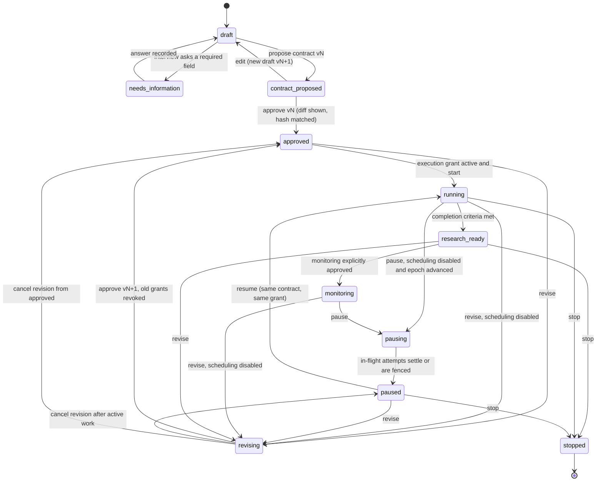

# Snowball Goal-Driven Research Harness

Date 2026-10-09

Status: Design approved for implementation on 2026-10-10 — runtime acceptance pending; no personal goal contract or execution grant is implicitly approved.

Baseline: commit 2086505 (tracked-source snapshot). Model: claude-fable-5-1.

Integration review: the Fable-authored proposal is revised here after an independent Fable UX audit, a source-grounded evidence/migration audit, and four workflowz research analyses through `agy-pool/gemini-3.8-flash`. These are design reviews, not implementation or production acceptance evidence.

## 0. How to read this document

Three kinds of statements appear and are labelled where it matters:

- MEASURED: behaviour read directly from the baseline source, cited as path and symbol or line.
- SUPPLIED: execution evidence provided by the parent process (the 217-test offline suite, the real-SQLite-clock smoke, the production dry-run). None of it was run by the author of this document.
- PROPOSED: the redesign. Finite numbers marked RECOMMENDATION are starting values that need user approval; they are not current configuration.

Implementation is in progress under the user's 2026-10-10 approval. Actual model design reviews and collected primary-source research are recorded in section 15; supplied scheduler verification is distinct from redesign acceptance. The G01–G30 gates require fresh implementation evidence.

## 1. Intent register

| Item | Status | Source |
|---|---|---|
| Degree level is a master's; PhDs are not a match. The existing direct-PhD seed is historical configuration, not user approval to research an alternative. | Master's confirmed; alternative unapproved | user brief; topics.highered.yml |
| Modality is on-campus, not online. | Confirmed (historical explicit intent) | user brief |
| Funding must be fully free or funded, accounted per component. | Confirmed as objective; thresholds unknown | user brief |
| CS/AI, study abroad, 2027 entry; compare tuition/living, RA/TA conditions, visa/application upfront costs and net INR cost. | Historically stated in recovered Hermes research; reconfirm before a new contract | retained direct-message/loop record; seed configuration |
| Nationality, GPA, tests, finances, current eligibility, cash thresholds, acceptance of conditional RA/TA, acceptance of competitive-only awards, countries, timelines. | Unknown; never assumed | user brief |
| Application, outreach, purchase, acquisition spend. | Not authorised | user brief |
| Worker currently inactive and disabled across reboots; readonly dashboard active. | Current deployment fact | user brief |

The interview in section 4 exists to move items from Unknown to Confirmed. The harness never promotes a draft to a locked value on its own.

## 2. Alternatives considered and the chosen shape

| Option | What it would look like | Why not (or why) |
|---|---|---|
| A. One large agent prompt holding the goal, with the model choosing searches and judging novelty | Rewrite waves 0 to 4 around a chat loop | The user raised this option. It cannot enforce approval, durable state, resource limits or evidence qualification by itself; letting a model judge novelty also breaks I2. |
| B. Keep the crawler untouched and bolt a goal filter on the dashboard | Post-hoc filtering of entities | The crawler would still spend budget on non-goal nodes, the evidence model cannot express funding components, and nothing stops a restart from running unapproved work. |
| C. Generic multi-agent platform with plugin planners and tool-using subagents | New framework and dependencies | Over-scoped, hard to audit, multiplies prompt-injection surface, and needs no capability the stdlib and SQLite cannot give. |
| D. Goal control plane above the existing acquisition and evidence engine (chosen) | Small static system policy; immutable versioned contract; mutable versioned strategy ledger; narrow compiled prompts; typed proposals validated by code; deterministic scheduler with persisted reasons | Reuses the measured locks, SSRF pinning, robots and access policy, budgets, leases, wiki and compiler. Adds state, not a new runtime. |

Option D is chosen. The engine below the control plane keeps its structure: fetch router, lock engine, substring guard, mechanical checks, quote check, hub diffing, token budget middleware, occurrence leases and the wiki compiler.

### 2.1 Layering

```
  user  <-- console (tools/console.py: interview, contract review, approvals, shortlist, activity)
   |
   v
  goal control plane (tools/goal.py)      : goals, contracts(v), profile fields, grants, strategies(v), events, epoch
   |          |
   |          v
   |     research loop (tools/orchestrator.py + tools/planner.py + tools/qualify.py)
   |       gaps -> typed proposals -> validate/dedupe/reserve/schedule -> fetch/extract/review -> observations -> evaluations -> ledger -> next strategy
   v
  acquisition and evidence engine (existing): FetchRouter, LockEngine, TokenBudgetMiddleware, Store, wiki_compiler
```

Models remain tool-less. Public calls receive a small system policy, a compiled task, a public research frame and fenced public-source text. They never receive the private profile snapshot or private evaluation results, never decide novelty and never execute page instructions. The core lifecycle, ledger and scheduler are domain-neutral. The master's-funding profile supplies its typed constraints and evaluators; `masters` and `on_campus` are this goal's confirmed values, not constants embedded in the global prompt or frame compiler.

### 2.2 Goal lifecycle (state diagram)



Substates of running (last strategy outcome, not goal states): progressing, exhausted, partial_coverage, outage, verifier_unavailable, empty_frontier, blocked, no_match, stalled. A canonical unchanged-work/coverage fingerprint identifies stalled without letting the model judge novelty.

## 3. Prompt policy: four layers, none of them a giant prompt

| Layer | Mutability | Owner | Carried in |
|---|---|---|---|
| System policy | Static text, versioned in code | tools/prompts.py | Every cloud call. About 15 lines: untrusted-source rule, no tools, verbatim quotes, JSON only, canary. Replaces EXTRACT_SYSTEM and VERIFY_SYSTEM at tools/orchestrator.py lines 1770 and 1786. |
| Goal contract | Immutable per version | goal_contracts body and profile snapshot | Never sent as such to cloud. Compile the approved public projection once; its hash is independent of the private snapshot. |
| Research strategy | Mutable, versioned | strategies.body_json | Drives scheduling in code. Only the planner call receives a compact coverage summary derived from it. |
| Compiled task prompt | Built per task | tools/prompts.py compile_* functions | System policy + task section (program, field list, schema) + research frame + fenced source. prompt_version stored on every observation, review and hypothesis. |

The prompt registry stores versioned task schemas and static policies. Compilers return `CompiledPrompt` with system/user text, version, source snapshot IDs and public frame hash. Persist policy/template hashes or bytes needed to audit a call; remove superseded executable aliases at cutover rather than retaining dead branches because history references a version. Leaves update the strategy ledger and task inputs, never the approved goal, privacy policy or system rules.

## 4. Goal control plane

### 4.1 Tables (PROPOSED, schema version 4)

```sql
CREATE TABLE goals (
  id INTEGER PRIMARY KEY, slug TEXT NOT NULL UNIQUE, title TEXT NOT NULL,
  state TEXT NOT NULL CHECK (state IN ('draft','needs_information','contract_proposed','approved','running','pausing','paused','revising','research_ready','monitoring','stopped')),
  current_contract_version INTEGER, current_strategy_version INTEGER NOT NULL DEFAULT 0,
  epoch INTEGER NOT NULL DEFAULT 0, row_version INTEGER NOT NULL DEFAULT 0,
  revision_from_state TEXT, stop_reason TEXT, created_at INTEGER NOT NULL, updated_at INTEGER NOT NULL);
CREATE TABLE goal_contracts (
  goal_id INTEGER NOT NULL REFERENCES goals(id), version INTEGER NOT NULL,
  status TEXT NOT NULL CHECK (status IN ('draft','proposed','approved','superseded','discarded')),
  body_json TEXT NOT NULL, body_hash TEXT NOT NULL,
  profile_snapshot_json TEXT NOT NULL, profile_snapshot_hash TEXT NOT NULL,
  frame_json TEXT, frame_hash TEXT,
  created_at INTEGER NOT NULL, approved_at INTEGER, approved_via TEXT, supersedes_version INTEGER,
  PRIMARY KEY (goal_id, version));
CREATE TABLE profile_fields (
  goal_id INTEGER NOT NULL REFERENCES goals(id), key TEXT NOT NULL, value_json TEXT,
  status TEXT NOT NULL CHECK (status IN ('known','draft','unconfirmed')),
  provenance TEXT NOT NULL CHECK (provenance IN ('user_stated','user_confirmed','imported_history','system_default')),
  visibility TEXT NOT NULL DEFAULT 'private' CHECK (visibility IN ('private','public_ok')),
  row_version INTEGER NOT NULL DEFAULT 0, updated_at INTEGER NOT NULL, PRIMARY KEY (goal_id, key));
CREATE TABLE interview_sessions (id INTEGER PRIMARY KEY, goal_id INTEGER NOT NULL REFERENCES goals(id),
  state TEXT NOT NULL CHECK (state IN ('open','closed')), created_at INTEGER NOT NULL, closed_at INTEGER);
CREATE TABLE interview_turns (id INTEGER PRIMARY KEY, session_id INTEGER NOT NULL REFERENCES interview_sessions(id),
  seq INTEGER NOT NULL, kind TEXT NOT NULL CHECK (kind IN ('question','answer','note')), field_key TEXT,
  text TEXT NOT NULL, created_at INTEGER NOT NULL, UNIQUE (session_id, seq));
CREATE TABLE execution_grants (
  id INTEGER PRIMARY KEY, goal_id INTEGER NOT NULL REFERENCES goals(id), contract_version INTEGER NOT NULL,
  mode TEXT NOT NULL CHECK (mode IN ('research','monitoring')),
  state TEXT NOT NULL CHECK (state IN ('active','exhausted','revoked','expired')),
  limits_json TEXT NOT NULL, starts_at INTEGER NOT NULL, expires_at INTEGER NOT NULL,
  row_version INTEGER NOT NULL DEFAULT 0, created_at INTEGER NOT NULL, revoked_at INTEGER, revoke_reason TEXT,
  FOREIGN KEY (goal_id, contract_version) REFERENCES goal_contracts(goal_id, version));
CREATE UNIQUE INDEX one_active_grant ON execution_grants(goal_id) WHERE state='active';
CREATE TABLE strategies (
  goal_id INTEGER NOT NULL REFERENCES goals(id), version INTEGER NOT NULL, contract_version INTEGER NOT NULL,
  body_json TEXT NOT NULL, outcome TEXT, reason TEXT, created_at INTEGER NOT NULL, PRIMARY KEY (goal_id, version));
CREATE TABLE goal_events (
  id INTEGER PRIMARY KEY, goal_id INTEGER NOT NULL REFERENCES goals(id), at INTEGER NOT NULL,
  actor TEXT NOT NULL, kind TEXT NOT NULL, operation TEXT NOT NULL, from_state TEXT, to_state TEXT, payload_json TEXT,
  idempotency_key TEXT, request_hash TEXT, result_status INTEGER, result_json TEXT,
  UNIQUE(actor, operation, idempotency_key));
```

`profile_fields` is an interview draft workspace, not the authority for a running goal. Proposing vN freezes its values, confirmation, provenance and visibility in `goal_contracts.profile_snapshot_json`; its hash is part of the reviewed contract hash. Evaluations and public-frame compilation read that immutable snapshot. Editing a locked goal requires `revise`, a new proposal and explicit approval; a draft edit can never change vN's financial thresholds or its cloud projection.

| Path | Type | Rule |
|---|---|---|
| objective.domain | named typed profile | The master's-funding profile is specified here; the lifecycle/compiler does not silently substitute it for an unsupported domain. |
| objective.degree_level | enum masters | Fixed for this goal; phd never matches. |
| objective.modality | enum on_campus | Fixed. online or hybrid-remote never matches. |
| objective.field_tags | list of strings | Draft until confirmed (CS/AI is draft context). |
| scope.regions | list of strings or empty | Empty means not yet confirmed; empty does not mean worldwide. |
| scope.intake_windows | list of strings like 2027-fall | Draft until confirmed. |
| funding.required_components | typed expense/support/liquidity rules | Explicitly confirm tuition, mandatory fees, living amount/duration, insurance, visa/application/travel costs, deposits and proof-of-funds liquidity. These are not all additive expenses. Suggested comprehensive coverage is a proposal, not a confirmed preference. Tuition and living remain core to this funding-first master's objective. |
| funding.grants_only | bool | Loans never satisfy a component when true. |
| funding.accept_conditional_ra_ta | bool or null | null means unknown, which keeps conditional packages in 'conditional', never 'met'. |
| funding.accept_competitive_awards | bool or null | Same semantics. |
| funding.threshold_refs | list of profile keys | Resolve only inside this contract version's frozen profile snapshot; never against live interview fields. |
| exclusions | list | This master's goal excludes PhDs and online degrees. Historical alternative seeds are not executed without a separately approved scope change. |
| completion.min_candidates | int | Minimum matching opportunities required for a positive research-ready shortlist; RECOMMENDATION 5, pending approval. Rejected programs do not count. |
| completion.critical_fields | list of field keys | Fields requiring current, applicable, reviewed evidence. Includes tuition, mandatory fees, living amount and duration, insurance, funding conditions and cycle applicability. |
| monitoring.refresh_policy | object | An immutable description of permitted refresh work, not an enabled flag. Starting monitoring requires an explicit mode=monitoring execution grant and transition. |
| execution_policy.lifetime_limits | finite node/depth/queue ceilings | Approved ceilings persist across contract revisions and grants; an increase requires an explicitly reviewed policy revision, and prior goal usage is not reset. Daily grants may allocate smaller allowances. |

`body_hash = sha256(canonical_json({"body": body_json, "profile_snapshot": profile_snapshot_json}))`, with sorted keys and no whitespace. Approval presents the hash actually reviewed. The private snapshot and this private-contract hash are not sent to cloud models; the separately compiled public frame has its own public hash.

### 4.2 Transition table: what each transition writes and invalidates

| Transition | Preconditions | Writes | Invalidates | Resumable after outage |
|---|---|---|---|---|
| create goal | none | goals(state=draft, epoch=0), goal_events | nothing | yes |
| record interview answer | state draft, needs_information, contract_proposed or revising; field and goal CAS match | draft profile_fields and interview_turns; invalidate an edited proposal | no approved snapshot changes | yes |
| propose contract vN | material fields confirmed, or an explicit bounded open-scope policy approved; state draft or revising | freeze profile_snapshot_json, contract body and public frame under vN; store their hashes | prior unapproved proposal discarded | yes |
| approve contract vN | reviewed version/hash and goals.row_version match | approve vN; supersede older version; state approved; epoch advances; record redacted change event | older evaluations stale; old pending tasks invalidated and grants revoked | yes |
| grant execution | approved current contract; validated limits, mode and interval | one active grant, explicit replacement revokes any old grant in the same transaction | no implicit new allowance or start | yes |
| start | state approved; active research grant for current contract | state running; create the next monotonic strategy version | nothing | yes |
| pause | state running or monitoring | state pausing, epoch+1, scheduling disabled, event | no new calls admitted; in-flight calls may settle as raw evidence, not current evaluations | yes; expose in-flight count |
| finish pause | state pausing; no live owned attempts remain | state paused | expired leases stay fenced | yes |
| resume | state paused; active grant matches current contract and requested mode | state running or monitoring as explicitly requested; epoch+1 | old pending bindings must be replaced explicitly | yes |
| revise | state approved, running, paused, monitoring or research_ready | save revision_from_state, disable scheduling, draft vN+1, epoch+1 | approved vN unchanged; old live results cannot qualify a new version | yes |
| cancel revision | state revising; user explicitly discards draft | discard proposal; restore approved/research_ready/paused, but previously active work returns paused | never auto-resume calls | yes |
| replan | state running; contract unchanged | next monotonic strategy version and persisted reason | no goal changes; admitted old-strategy tasks may drain if contract/epoch remain valid | yes |
| stop | any non-stopped state | stopped, reason, epoch+1, revoke grants and cancel pending tasks | late results cannot qualify; raw evidence retained | n/a |
| research_ready | code verifies the positive completion predicate | state research_ready; scheduling disabled | no admission or award asserted | yes |
| monitoring | state research_ready; explicit current-contract monitoring grant | state monitoring; record consent event | no mutation of the approved contract | yes |

Optimistic concurrency: every control mutation includes expected_row_version for the goal (or field or grant) and is applied with UPDATE ... WHERE row_version=? ; zero rows updated returns HTTP 409 with the current row. Approval additionally requires the body_hash. Both run inside Store.tx() (BEGIN IMMEDIATE), the same helper the engine already uses at tools/orchestrator.py line 1554.

Idempotency is scoped by `(actor, operation, key)` and includes the canonical request hash. A same-key/same-request replay returns its stored result; a different request under that key is HTTP 409 `idempotency_conflict`. CAS, mutation and event/result storage happen in one transaction. Authentication and origin checks precede replay lookup.

No auto-lock: the harness never writes status='known' or provenance='user_confirmed' except from an interview answer carrying confirm=true. imported_history rows (if the user ever imports old Hermes notes) stay unconfirmed until confirmed individually.

### 4.3 Worker gate

PROPOSED function in tools/goal.py:

```
runnable_goal(store, now_ts) -> RunnableGoal | None
  returns the single goal with state in (running, monitoring),
  an approved current_contract_version, and an execution_grants row with
  state=active, contract_version=current, starts_at <= now < expires_at,
  and remaining ledger headroom for the day; else None with a reason code
  (no_goal, not_running, no_grant, grant_expired, grant_exhausted).
```

`SnowballOrchestrator.run` checks the goal gate before seeding or admitting work. No runnable goal produces an idle outcome, not acquisition calls. `--topic` may override a topic cooldown, never goal approval, privacy, grant or page-access checks. Dry-run uses an isolated in-memory copy, performs no external calls and reports the gates that would block. Console handlers own a connection per request; network workers return results to the orchestrator's owning thread. They never share the current unsynchronised `Store` connection across threads.

## 5. Interview and privacy model

### 5.1 Question bank

Questions are code-owned, keyed to contract and profile fields, ordered by dependency, and stored in tools/interview.py as a list of (field_key, question_text, answer_type, required, visibility_default). No model generates questions. The console shows one question at a time with the current draft value and provenance; the CLI offers the same bank. Free-text answers are stored verbatim locally in interview_turns and parsed by typed validators (money with currency, date windows, enums). Parsing failures return a 422 with the validator message; nothing is guessed.

Field groups (visibility_default in brackets): degree_level [public_ok, fixed], modality [public_ok, fixed], field_tags [public_ok], regions [public_ok], intake_windows [public_ok], required_components [public_ok], grants_only [public_ok], accept_conditional_ra_ta [private], accept_competitive_awards [private], max_upfront_cash [private], min_living_adequacy_rule [private], max_work_hours_acceptable [private], citizenship [private], prior_degree [private], academic_record [private, never requested unless the user adds it], tests [private, same], completion.min_candidates [public_ok], monitoring [public_ok].

### 5.2 Visibility enforcement

- Cloud compilers accept only a typed `PublicFrame` derived from the frozen approved profile, public source snapshots and public program metadata. They cannot accept a profile dictionary, private evaluations, interview text or arbitrary human notes.
- `validate_public_request` checks data provenance and the allowed request schema before dispatch. Query anchors and scope come only from the approved public projection and observed public names. Credential/canary scanning remains a separate defense. Do **not** blacklist every private numeric value across public source text: a private zero-cash budget must not block a public page containing `0` or `2027`, and a public GPA rule may legitimately equal the user's private GPA.
- Logs omit private values and private contract hashes. An outbound policy failure records field/type/reason, not the blocked data.
- The dashboard API returns private fields only on the authenticated console session and only to the interview and contract views; shortlist, activity and evidence payloads carry evaluation statuses, not thresholds.

### 5.3 Public research frame

The frame is compiled once from the version's frozen approved snapshot and stores its own hash. It contains `objective.domain`, confirmed public criteria and explicit scope policy. The master's-funding profile includes this goal's `degree_level=masters` and `modality=on_campus`; the global compiler copies confirmed values rather than hardcoding them. Empty scope means unconfirmed, never silently worldwide. A user may explicitly approve bounded broad research while personal eligibility remains unknown.

### 5.4 Private evaluation is code first

Private eligibility and numeric thresholds run in code against the frozen approved profile. Funding accounting separates expenses, refundable/credited deposits, disbursements, in-kind support and liquidity requirements. Proof-of-funds is a balance requirement, not a fee to add to tuition or deposits. Compute peak own cash from a dated cash-flow schedule without double-counting credited deposits or reusing mutually locked balances; unknown timing or compatibility keeps upfront-liquidity status unknown. Living support is compared against costs for the same location and period, with housing/insurance included exactly once; never multiply an unspecified funding period into an assumed annual full ride. Unstructured private eligibility interpretation uses only an attested local endpoint:

- PRIVATE_MODEL_ENDPOINT is separate from public transports and the AGY proxy, and requires operator attestation plus documented serving-daemon egress isolation. Loopback alone is not proof: another local proxy can forward to cloud. Endpoint checks/attestation are diagnostics, not a network-isolation guarantee.
- Without a verified local deployment interpretation stays unknown/local_model_required and requires human review. Deterministic private comparisons continue without a model. No cloud fallback or silent model-to-retrieval downgrade.

### 5.5 Separation and consent

Public generic program research (what a program costs and funds, for anyone) and private eligibility evaluation (does this person meet it) are different task kinds with different engines and different tables. The console shows the split explicitly and the interview asks for consent to run private evaluation at all; until consent is recorded the private step is not scheduled.

## 6. Adaptive research loop

### 6.1 Wave shape

One wave for a runnable goal:

1. Coverage: tools/qualify.py coverage(goal, contract_version) lists, per candidate program, each required field with status met, unmet, unknown or conditional and its assurance. Contradictions and stale snapshots are listed as gaps.
2. Code gap proposals: for each unknown critical field of a shortlisted program, a templated query (program name + official domain token + field template) with discovered_via='gap'. Deterministic, no model.
3. A bounded tool-less planner call receives only public source coverage: observed names/domains and missing/contradicted public facts. Per-user eligibility results, private thresholds and personal-fit reasons are not part of that context.
4. Validate, dedupe, reserve, schedule: tools/planner.py validate_proposals applies the rules in 6.3, LockEngine.query_lock and enqueue_url dedupe, the resource ledger reserves counters, frontier_decisions records the reason for every selection, deferral or drop.
5. Fetch, extract, review: existing router and locks; extraction uses compile_extract_fields; review uses compile_review_observations over observations.
6. Qualification evaluates each compatible package locally against the frozen approved profile and writes version/epoch-bound statuses. Reviewing a source quote is not proof that a real funding offer exists.
7. Ledger and strategy: strategies(v+1) records what moved, what is exhausted, and the next wave's focus; the outcome substate is set.

### 6.2 JSON contracts

Planner input (compiled by code):

| Field | Content |
|---|---|
| frame | public research frame (5.3) |
| programs | list of {program_key, name, official_domain, unknown_fields[], contradictions[]} for at most 20 programs |
| exploration_budget | integer count of new-candidate hypotheses allowed this wave |
| known_domains | domains already fetched for these programs |

Planner output (model returns exactly this object; anything else is rejected):

| Field | Type | Validation (code) |
|---|---|---|
| hypotheses[] | list | at most PLAN_MAX_HYPOTHESES_PER_WAVE (RECOMMENDATION 6) |
| hypotheses[].kind | enum search or fetch | other values drop the item |
| hypotheses[].program_key | string or null | must exist in programs input or be null for exploration |
| hypotheses[].field_key | string or null | must be a known field key |
| hypotheses[].query | string (search only) | lexical anchor from the approved public frame or an observed public program/domain; approved scope/provenance; 8–200 chars; no model-invented private profile or eligibility parameters |
| hypotheses[].url | string (fetch only) | must canonicalise to a URL already present in page_links, hub_rows or queries results for this goal; model-invented URLs are dropped |
| hypotheses[].rationale | string | Untrusted model explanation, max 300 chars; kept separately. The authoritative selection/deferral reason is computed by code from validated inputs. |

Extractor output (compile_extract_fields):

| Field | Type | Validation (code, existing guards reused) |
|---|---|---|
| program | {name, institution, degree_level, modality} | name verbatim in source (substring guard) |
| observations[] | typed records: value/currency/period, actual applicability, subject/award/campus identity, quote and source offsets | Requested field only; exact immutable-source substring; numeric/unit/date/subject binding, not “a number somewhere on this page”; unknown period/applicability remains unknown. ISO currency or null; no assumed yearly duration. |
| names[] | list | verbatim in source, existing rule |
| links[] | list | present in source text, existing rule |

Reviewer output (explicit positive/negative observation verdicts, not a funding guarantee):

| Field | Type | Effect |
|---|---|---|
| verdicts[].id | int | observation index |
| verdicts[].verdict | keep or drop | drop sets assurance reviewed_dropped with reason; keep sets reviewed_kept |
| verdicts[].reason | string | stored |
| verdicts[].unsupported | list of field names | stored |

An observation absent from verdicts, a malformed reply, an outage or an unavailable reviewer sets assurance review_pending (or review_unavailable when no reviewer is configured at all). Neither value qualifies a critical field.

### 6.3 I1 amendment and provenance classes

Old I1 (docs/SYSTEM_DESIGN.md section 1.4): after day one every query has discovered_via in hub, name, backlink, similar, never llm. This design amends I1 deliberately:

> I1 (amended): code seeds and the web supplies facts. A model may propose search hypotheses or a fetch of an already-seen URL. Code validates the public request's scope/provenance, deduplicates it, checks access policy and reserves bounded resources. `hypothesis` and code-generated `gap` are scheduling provenance, never evidence. Only source-backed, reviewed observations can support current qualification.

Provenance classes stored on every row that can influence research:

| Class | Where | Meaning |
|---|---|---|
| FACT | observations, claims, entities (new rows), programs with provenance observed | Backed by a quote span in a stored snapshot. |
| HYPOTHESIS | queries.discovered_via hypothesis or gap, frontier_decisions | Scheduling intent only. |
| LEAD | entities and claims with provenance legacy_v3; programs with provenance lead_legacy | Historical rows; can seed refetches, never qualify. |
| HUMAN_NOTE | wiki human regions | Shown, cited as a note, never evidence. |

### 6.4 Next-node eligibility and priority

Eligibility (hard, all must hold; checked in SQL and in the ledger reservation): goal epoch current; domain status ok and not paused; page not walled, dead, dropped, quarantined; page next_attempt_at and next_check_at due; depth at or below GRANT depth cap; grant counters have headroom; per-domain in-flight below cap; for queries, query_key not locked in the current window and per-program-field cooldown not active.

Priority (PROPOSED, RECOMMENDATION weights):

```
score = goal_value * uncertainty * authority * freshness_need / cost
  goal_value    1.0 node targets a shortlisted program with an unknown critical field
                0.6 exploration (possible new candidate)
                0.2 anything else (kept so general hub refresh can still happen)
  uncertainty   0.1 + 0.9 * (unknown critical fields of the target program / total critical fields)
  authority     1.0 official program or institution domain; 0.9 scholarship body; 0.5 aggregator or hub; 0.3 forum or social
  freshness_need 1.0 no snapshot in the current cycle or snapshot due; 0.3 fresh snapshot exists
  cost          1 + estimated_tokens / 100000 + (1 if a paid route would be needed else 0)
```

Exploration versus verification: at most EXPLORATION_SHARE (RECOMMENDATION 0.3) of a wave's page slots go to goal_value 0.6 nodes while any shortlisted program still has unknown critical fields.

Novelty is not progress: the existing novelty term stays inside pop_frontier for tie-breaking among equal-score nodes only; it no longer multiplies the score.

Every decision is persisted:

```sql
CREATE TABLE frontier_decisions (
  id INTEGER PRIMARY KEY, wave_id INTEGER NOT NULL, goal_id INTEGER NOT NULL, strategy_version INTEGER NOT NULL,
  node_kind TEXT NOT NULL CHECK (node_kind IN ('page','query')), node_id INTEGER NOT NULL,
  decision TEXT NOT NULL CHECK (decision IN ('selected','deferred','dropped')),
  score REAL, components_json TEXT NOT NULL, reason TEXT NOT NULL, at INTEGER NOT NULL);
```

reason is a short human sentence built by code, for example: deferred: domain example.edu paused until 14:05 after 429; or selected: tuition unknown for Program X, official domain, no snapshot this cycle.

### 6.5 Cooldowns

| Timer | Scope | Status |
|---|---|---|
| Topic recheck (last_run_at + recheck_days) | Seed refresh for a topic | Retained with the CAST fix; gates only the seed-query refresh of that topic. |
| Query window (query_key with window_key) | Same words, same source | Retained. |
| Page interval (interval_sec, next_check_at, next_attempt_at) | Each page | Retained, including outage refund and failure strikes. |
| Program-field cooldown | gap and hypothesis queries for (program, field) | New: PROGRAM_FIELD_QUERY_COOLDOWN_SEC (RECOMMENDATION 604800) unless the field became unknown again after a snapshot change. |

Gap and hypothesis work is scheduled per program and field, so new due work under a topic proceeds while that topic's seed refresh waits for its timer.

## 7. Resource enforcement

### 7.1 Ledger tables

```sql
CREATE TABLE resource_ledger (
  scope_key TEXT NOT NULL,
  window_kind TEXT NOT NULL CHECK (window_kind IN ('day','lifetime')), window_key TEXT NOT NULL,
  counter TEXT NOT NULL, reserved INTEGER NOT NULL DEFAULT 0 CHECK (reserved >= 0),
  settled INTEGER NOT NULL DEFAULT 0 CHECK (settled >= 0), lost INTEGER NOT NULL DEFAULT 0 CHECK (lost >= 0),
  PRIMARY KEY (scope_key, window_kind, window_key, counter));
CREATE TABLE resource_reservations (
  id INTEGER PRIMARY KEY, grant_id INTEGER NOT NULL REFERENCES execution_grants(id), task_id INTEGER,
  operation_key TEXT NOT NULL, scope_key TEXT NOT NULL, window_kind TEXT NOT NULL, window_key TEXT NOT NULL,
  counter TEXT NOT NULL, amount INTEGER NOT NULL CHECK (amount > 0),
  actual INTEGER CHECK (actual IS NULL OR actual >= 0), state TEXT NOT NULL CHECK (state IN ('reserved','settled','lost')),
  created_at INTEGER NOT NULL, settled_at INTEGER,
  UNIQUE (grant_id, operation_key, scope_key, window_kind, window_key, counter));
```

`scope_key` is code-generated for the goal or shared model-role total. Goal/day and lifetime usage span contract versions: revision or grant renewal cannot reset usage. Unique queued/visited identities count once across the goal's versions; depth/priority remain version-specific associations. The approved contract supplies finite lifetime ceilings, with grants bounded by them. Reserve goal and shared-role counters atomically. Existing OMP `_call` paths ignore max_out or omit some system/reasoning usage; estimated accounting is not a provider-token/billing guarantee. Hard mode stays blocked until a bounded public transport and trustworthy usage reconciliation are demonstrated.

Grant limits carry daily attempts/calls, lifetime unique queued/visited identities, queue occupancy, depth/domain bounds, active time and expiry. Starting recommendations—not activated: 40 fetches/day, 12 queries/Exa calls, 6 hypotheses, depth 3, 2 in-flight/domain, queue 400, lifetime nodes 1500, 3 active hours/day and 14-day expiry. Existing 800000/600000/200000 total/extraction/review token figures are requested accounting ceilings; transport/usage proof is required before calling them hard provider-token caps. Plan usage also consumes the shared total allowance.

### 7.2 Atomic reserve

```
reserve_batch(store, grant_id, operation_key, amounts, binding) -> reservation_ids
  BEGIN IMMEDIATE
    verify approved contract/epoch, runnable state and active grant
    if already admitted: validate identical bundle/binding; return its prior disposition
    read all day/lifetime/shared-role headroom and domain-slot ownership
    if any bound fails: ROLLBACK; admit nothing
    write all counter reservations and dispatch/lease identity together
  COMMIT
```

An already-dispatched/terminal operation is not dispatched again because reservation replay succeeds. A deliberate retry uses a new occurrence/key and consumes new allowance. Settlement moves reserved/settled/lost usage without double-counting. Ambiguous timeouts stay charged; only provably undispatched work refunds. An actual overrun stops new admissions rather than claiming the cap held. Admission windows stay attached across midnight.

Reaping fences the old occurrence and marks unresolved dispatched reservations lost. Domain slots are persisted/leased in the admission transaction; semaphores are only an optimization, not cross-process authority. Stale results can append raw attempt evidence and usage but cannot overwrite a newer page snapshot, reclaimed task or current-goal evaluation.

### 7.3 Failure and crash policy

| Event | Policy |
|---|---|
| Engine outage | Retry scheduling may refund an attempt under the existing policy; accounting releases only provably undispatched work. Ambiguous dispatched usage remains lost/reserved conservatively. |
| Engine failure | strike (existing), reservation settled with actual work. |
| Worker crash mid-task | reaper reclaims the task, bumps occurrence_seq, marks reservation lost. |
| Grant exhausted mid-wave | wave finishes the already-reserved items, no new reservations, outcome exhausted. |
| Day rollover | Charge an admitted call to its admission window; hold its outstanding reservation until settled. Lifetime node usage never resets. The new day does not erase unknown provider charges. |

### 7.4 Daily windows

Windows are IST days, matching engine_spend and budgets (today_ist at tools/orchestrator.py line 144).

### 7.5 Outcome substates

| Substate | Definition | What the user sees |
|---|---|---|
| progressing | At least one constraint status changed from unknown this wave | counts of fields resolved |
| exhausted | A grant counter or token ceiling hit before the wave plan completed | which counter, when it resets |
| partial_coverage | Wave completed but some shortlisted programs still have unknown critical fields and no eligible node remains for them today | list of program and field pairs |
| outage | Extractor, reviewer, Exa or a majority of domains paused | which engine or domains, pause until |
| verifier_unavailable | Reviewer unavailable; observations accumulate as review_pending | count pending review |
| empty_frontier | No eligible node and no valid proposal | suggestions: broaden scope (needs contract revision) |
| blocked | All remaining nodes for a program are walled, robots-excluded or access-denied | per program, the barrier kind |
| no_match | Every candidate has at least one hard constraint unmet with reviewed_kept assurance | explicit; not a failure of the harness |
| user_stopped | stop transition | stop reason |
| research_ready | completion criteria met (7.6) | shortlist ready for a human decision; not admission, not funding |
| monitoring | explicit mode; only refresh of due snapshots for shortlisted programs | next refresh times |

### 7.6 Completion

`research_ready` requires the approved number of current-version matching packages, no unknown hard/critical facts or unresolved critical contradictions, reviewed support and actual target-intake applicability. Required outcomes are met; conditional outcomes may count only where the user explicitly accepted that specific condition and the predicate records acceptance. They stay labelled **conditional**, never guaranteed awards. Rejected programs do not count. Zero matches means “no matches among candidates checked”, not global impossibility; exhaustion/empty queue is partial coverage. Admission/awarded funding requires external offer evidence; this harness does not apply for the user.

Monitoring is never implicit. Without the monitoring transition the goal sits in research_ready and the worker idles for it.

## 8. Evidence model

### 8.1 Tables

```sql
CREATE TABLE programs (
  key TEXT PRIMARY KEY, name TEXT NOT NULL, institution TEXT, country TEXT, official_domain TEXT,
  degree_level TEXT CHECK (degree_level IN ('masters','phd','other','unknown')),
  modality TEXT CHECK (modality IN ('on_campus','online','hybrid','unknown')), field_tags_json TEXT NOT NULL DEFAULT '[]',
  provenance TEXT NOT NULL CHECK (provenance IN ('observed','lead_legacy')),
  first_seen_at INTEGER NOT NULL, last_seen_at INTEGER NOT NULL);
CREATE TABLE source_snapshots (
  id INTEGER PRIMARY KEY, page_id INTEGER NOT NULL REFERENCES pages(id), fetch_id INTEGER REFERENCES fetches(id),
  content_hash TEXT NOT NULL, retrieved_at INTEGER NOT NULL, text_path TEXT NOT NULL, original_raw_path TEXT,
  visibility TEXT NOT NULL DEFAULT 'private' CHECK (visibility IN ('public','private')),
  provenance TEXT NOT NULL DEFAULT 'unknown', source_cycle_label TEXT, applicability_json TEXT NOT NULL DEFAULT '{}',
  superseded_by INTEGER REFERENCES source_snapshots(id));
CREATE TABLE observations (
  id INTEGER PRIMARY KEY, snapshot_id INTEGER NOT NULL REFERENCES source_snapshots(id), page_id INTEGER NOT NULL,
  program_key TEXT REFERENCES programs(key), field_key TEXT NOT NULL, value_json TEXT NOT NULL,
  subject_json TEXT NOT NULL,
  currency TEXT, period TEXT CHECK (period IN ('per_year','per_semester','per_month','one_time','total')), as_of TEXT,
  conditions_json TEXT, quote TEXT NOT NULL, quote_start INTEGER NOT NULL, quote_end INTEGER NOT NULL,
  extractor_model TEXT NOT NULL, prompt_version TEXT NOT NULL,
  assurance TEXT NOT NULL CHECK (assurance IN ('code_checked','reviewed_kept','reviewed_dropped','review_pending','review_unavailable')),
  review_model TEXT, review_reason TEXT, task_id INTEGER, goal_id INTEGER, contract_version INTEGER, strategy_version INTEGER, epoch INTEGER,
  created_at INTEGER NOT NULL, invalidated_at INTEGER, invalidated_reason TEXT);
CREATE TABLE funding_packages (
  key TEXT PRIMARY KEY, program_key TEXT NOT NULL REFERENCES programs(key),
  cycle_label TEXT NOT NULL, award_keys_json TEXT NOT NULL, components_json TEXT NOT NULL,
  compatibility_basis_ids_json TEXT NOT NULL, cash_flow_json TEXT NOT NULL,
  basis_observation_ids_json TEXT NOT NULL, computed_at INTEGER NOT NULL);
CREATE TABLE constraint_evaluations (
  goal_id INTEGER NOT NULL, contract_version INTEGER NOT NULL, program_key TEXT NOT NULL, constraint_key TEXT NOT NULL,
  package_key TEXT NOT NULL REFERENCES funding_packages(key),
  status TEXT NOT NULL CHECK (status IN ('met','unmet','unknown','conditional')), basis_json TEXT NOT NULL, reason TEXT NOT NULL,
  evaluated_at INTEGER NOT NULL, epoch INTEGER NOT NULL, stale_for_goal INTEGER NOT NULL DEFAULT 0,
  PRIMARY KEY (goal_id, contract_version, package_key, constraint_key));
CREATE TABLE contradictions (
  id INTEGER PRIMARY KEY, program_key TEXT NOT NULL, field_key TEXT NOT NULL, observation_a INTEGER NOT NULL, observation_b INTEGER NOT NULL,
  precedence_rule TEXT, winner INTEGER, resolved_at INTEGER, resolution_reason TEXT);
CREATE TABLE fx_rates (base TEXT NOT NULL, quote TEXT NOT NULL, rate_decimal TEXT NOT NULL, as_of TEXT NOT NULL,
  source_page_id INTEGER, PRIMARY KEY (base, quote, as_of));
```

### 8.2 Field keys and the funding package

Field keys (one list in tools/qualify.py FIELD_KEYS): degree_level, modality, field_of_study, intake_cycle, application_deadline, tuition, mandatory_fees, living_support_amount, living_support_duration, health_insurance, visa_costs, application_fee, deposit, travel_relocation, proof_of_funds, work_hours_required, renewal_conditions, gpa_conditions, award_type (guaranteed, competitive, conditional_ra_ta, loan, discount), funding_source_official, eligibility_text, cycle_dates.

Packages are specific compatible award combinations for a program and intake, not the maximum tuition and living amounts found across unrelated schemes. Each component identifies its award, period, disbursement timing and source observations. Combining awards requires evidenced stacking compatibility; missing compatibility is unknown. A loan is not grant funding. A partial discount may reduce costs but cannot by itself establish full coverage. Competitive, conditional RA/TA and renewal-dependent support remain visibly conditional even when the user accepts considering them; an unsupported hoped-for appointment never becomes guaranteed.

### 8.3 Per-constraint evaluation

For each `(goal, approved version, package)`, evaluate required typed funding, study/eligibility, scope and private-threshold criteria:

- Unknown is never met: missing applicability, unsupported period/equivalence, unconfirmed material profile, pending/unavailable review or invalidated support stays unknown.
- Met requires applicable reviewed evidence correctly bound to program/award/campus, value/unit and intake, satisfying the frozen rule.
- Unmet requires supported evidence violating the rule; missing information alone is not unmet.
- Conditional describes a documented contingency. Explicit acceptance may admit a conditional shortlist candidate but never erases the condition or asserts award receipt; refusal fails its acceptance criterion.
- Thresholds resolve only against `goal_contracts.profile_snapshot_json` for the approved version. Evidence basis stores snapshot/observation IDs, the profile snapshot hash and key, not a live mutable value.
- Compare the same expense/support period and currency. Cross-currency calculations use a dated sourced rate and record the conversion; no current rate means unknown. Record explicit duration rather than assuming every semester or stipend has twelve months. Upfront liquidity follows the cash-flow schedule, separately from total cost and proof-of-funds balances.

### 8.4 Contradictions and precedence

Conflicts are within the same subject/award/campus/field and applicable scope, not unrelated schemes. Official provenance helps assess authority but cannot resolve two conflicting official policies alone. Prefer an explicitly superseding/effective policy only with evidence; later retrieval cannot make an old call newer. Preserve both observations and resolution basis. Unresolved decisive conflicts keep qualification unknown and visible for human review.

### 8.5 Invalidation and refresh

- A new snapshot with a different content_hash for a page invalidates observations from the previous snapshot (invalidated_reason source_changed) and re-queues extraction from the stored raw text.
- Approving a new contract version flags evaluations of older versions stale_for_goal=1; observations stay valid.
- An epoch change does not invalidate observations; it only rejects late commits from tasks bound to the old epoch.
- Target intake belongs to the goal/task, never to source metadata by assignment. Source cycle/applicability is extracted from actual evidence and may be unknown. A page retrieved today does not become current-cycle evidence automatically. A 2026 announcement explicitly for 2027 admissions can be valid; an old 2026 call retrieved during a 2027 search cannot be relabelled 2027. Applicability uses declared cohort/effective scope and supersession evidence, not `as_of >= intake_start`.

### 8.6 Legacy data

Migration v4 adds entities.provenance and claims.provenance with default legacy_v3 for existing rows. Legacy rows are leads: they appear in the console as historical, can seed gap queries and refetches, and are never counted in funding_packages or constraint_evaluations. Nothing is deleted. The wiki keeps its pages; human-edited regions are indexed with provenance human_note.

### 8.7 Snapshot retention and shared-node ownership

Store exact immutable UTF-8 text at `text_path`, hash its bytes with full SHA-256 and record parser/encoding metadata. Preserve original HTML/PDF at `original_raw_path` separately when available. Quote offsets use Unicode code points in the persisted text, not UTF-8 bytes or JS UTF-16 offsets; `snapshot_text[start:end] == quote` must hold. Never overwrite snapshot bytes. Chunked model context maps quotes back to these offsets. Public snapshots require an explicit host-validated public_fetch provenance/visibility; unknown/private rows do not become public by default.

Retention pins snapshots referenced by observations, packages, evaluations, contradiction history or legacy claim/row evidence. It checks complete paths/references and cannot delete a whole dated directory containing pinned files. Garbage collection applies only to unreferenced bytes after a grace interval. A SQLite backup alone does not back up `raw/` or human-edited `wiki/`: the cutover bundle includes the referenced snapshot manifest/files and Markdown with checksums; restore reinstates them before read models or compilation.

Shared pages/query caches keep no single goal owner. Per-goal/version `goal_pages` (page, parent/depth, origin, visibility), `goal_queries` (query, program/field, origin), `goal_topics` and `goal_programs` (program, candidate/alternative role, visibility) associations are uniquely scoped. Priority, depth/queued/visited ceilings and personal evaluations live there. A program can have different roles/fits in two goals without overwrite. Private snapshots/notes cannot become PublicSourceSnapshot or shared public facts.


## 9. Console: redesigned frontend and control API

### 9.1 Ownership

tools/console.py (NEW) owns the HTTP server, embedded HTML/CSS/JS, session, CSRF, origin and host checks, read and write API. tools/visualize.py keeps the terminal view and the read-model query functions fetch_opportunities, fetch_graph_data and fetch_status_metrics, which console imports via the existing _sibling convention. DashboardServer and DashboardHandler are removed from visualize.py, not aliased. snowball.py serve dispatches to console.py.

### 9.2 Views (graph is secondary)

| View | Content | Empty and edge states |
|---|---|---|
| Goal (home) | Interview panel: one question at a time, draft value, provenance badge, visibility toggle, confirm button. Contract panel: current approved version, proposed version with a field-level diff, approve button that submits the reviewed hash. Change history from goal_events. Execution grant panel with limits and expiry. State badge and transition buttons. | no goal: create goal; needs_information: list of missing fields; proposed: diff view; stopped: reason |
| Shortlist | Programs by role (candidate, alternative) with per-constraint matrix cells met, unmet, unknown, conditional, contested; unknown cells link to the next planned node or to needs human review; funding package summary per program in source currency with period | no match: explicit no-match state; nothing evaluated yet; verifier unavailable banner |
| Activity | Live tasks with lease state, current strategy version, last frontier decisions with reasons, coverage counts, resource ledger gauges per counter, substate and stop reasons, engine availability | paused, blocked, outage, exhausted banners with reset times |
| Evidence | Per program: observations with quote, snapshot date, assurance, reviewer model, contradictions; legacy leads shown separately; human notes labelled | review_pending shown honestly |
| Graph | Existing force graph, moved to the last tab | unchanged behaviour |

No demo data, no invented opportunities. Every number in the UI is a database row.

### 9.3 Design tokens

Reuse the existing palette and type stacks (tools/visualize.py DASHBOARD_CSS lines 644-657). Add status tokens: --met (uses --verified), --unmet (uses --accent), --unknown (uses --muted), --conditional (new amber, light f0a65c equivalent from --n-hub), --contested (striped border). Layout: 8 px spacing scale, max content width 1200 px, single column under 720 px, matrix becomes a stacked list under 720 px. Keyboard: tabs with roving tabindex (existing), matrix cells focusable with Enter to open evidence, dialogs trap focus, Escape closes. Reduced motion respected (existing rule at line 810). CSP stays default-src none with script-src self and style-src self; connect-src self; form-action self is added only because the session form posts to the same origin.

### 9.4 Session and request security

- Bootstrap: the CLI prints a cryptographically random one-use token and stores only its hash/expiry. Login checks Host, the configured Origin, JSON/body bounds and a bounded unauthenticated login rate before atomically consuming the token and creating the session. Login is the explicit exception to existing-session/CSRF requirements: no session exists yet.
- Subsequent writes, including logout, require the valid HttpOnly/Secure/SameSite=Strict session plus `X-Snowball-CSRF`. Login and logout never log or echo credentials. Session creation, expiry and revocation are transactional.
- Allowed browser Origin is configured independently of Caddy's loopback Host rewrite; missing/foreign Origin is 403. Non-browser CLI control uses direct local commands, not an Origin bypass on HTTP.
- Preserve the Host guard and reject untrusted forwarded-origin/identity headers. Tailnet membership alone grants no control privilege.
- All new goal, interview, contract, grant, activity, shortlist, evidence and event APIs require the operator session, including reads; statuses can themselves reveal private preferences. Legacy public read endpoints remain public-safe projections and omit private rows/counts/goal metadata.
- Body: Content-Type must be application/json; body over 65536 bytes is 413; invalid JSON is 400; schema failure is 422 with field errors.
- Rate: 30 writes per minute per session, 429 beyond.
- Bind: 127.0.0.1 only; a non-loopback host flag is refused when control routes are enabled.

### 9.5 API

| Method and path | Body | Success | Errors |
|---|---|---|---|
| POST /api/session | token | 201 with csrf | 401 bad or used token |
| GET /api/session | - | 200 session info | 401 |
| DELETE /api/session | explicit empty body permitted; session/CSRF/Origin required | 204 | 401/403 |
| GET /api/goal | - | 200 current goal, contract versions, grant, state | 404 none |
| POST /api/goals | title | 201 goal | 409 a non-stopped goal exists |
| GET /api/goals/id/interview | - | 200 next question, fields with status, provenance, visibility | 404 |
| POST /api/goals/id/interview/answers | field_key, value, confirm, visibility, expected_row_version | 200 field | 409 version, 422 validator |
| POST /api/goals/id/contract/draft | body, base_version | 201 version | 422 |
| GET /api/goals/id/contract/diff?from=a&to=b | - | 200 field diff | 404 |
| POST /api/goals/id/contract/approve | version, body_hash, expected_row_version | 200 | 409 version or hash, 422 missing required fields |
| POST /api/goals/id/grants | contract_version, mode, limits, expires_at, expected_row_version; Idempotency-Key | 201 grant | 409 stale version/key, 422 limits |
| POST /api/goals/id/transition | to, reason, expected_row_version | 200 | 409 version, 422 illegal transition |
| GET /api/goals/id/shortlist | - | 200 programs, matrix, packages | |
| GET /api/goals/id/activity | - | 200 tasks, decisions, ledger, substate | |
| GET /api/goals/id/evidence/program_key | - | 200 observations, contradictions, snapshots | 404 |
| GET /api/goals/id/events | - | 200 history | |
| GET /api/entities, /api/graph, /api/status | - | legacy public-safe projection; no private counts/goal metadata | |

Error body: {error: code, message: text, details: object or null}. Database unavailable is 503 (existing behaviour kept).
Every new goal/read/control route requires the operator session. Login alone is an unauthenticated control bootstrap with its own validation/rate gate. Interview-answer expected_row_version is the goal CAS, not permission to edit a locked profile.

## 10. Files, interfaces, CLI, routing, operations

### 10.1 Ownership

| File | Status | Responsibility |
|---|---|---|
| tools/goal.py | NEW | goals, contracts, profile fields, interview storage, grants, strategies, events, transitions, CAS, runnable_goal, redact |
| tools/interview.py | NEW | question bank, typed validators, next_question, public frame compiler |
| tools/prompts.py | NEW | static policy, versioned registry, public-source/frame compilers, typed public request validation |
| tools/planner.py | NEW | coverage to gap proposals, planner call, validate_proposals, schedule with reasons |
| tools/qualify.py | NEW | FIELD_KEYS, funding package derivation, constraint evaluation, contradictions, FX, completion_status, coverage |
| tools/ledger.py | NEW | resource ledger reserve, settle, mark_lost, GrantExhausted |
| tools/console.py | NEW | HTTP server, sessions, CSRF, origin, control and read API, embedded UI |
| tools/orchestrator.py | EXISTING, modified | goal gate, leased fetch and commit, observation pipeline, ReviewEngine rename, removal of india_check and auto local fallback, migrations list, outcomes |
| tools/visualize.py | EXISTING, reduced | terminal view and read-model queries only |
| tools/ask.py | EXISTING, modified | human_note provenance labelling; private model attestation |
| tools/wiki_compiler.py | EXISTING, modified | provenance per indexed region |
| snowball.py | EXISTING, modified | goal, console, grant commands; serve to console |
| config.env, config.oracle.env | EXISTING, modified | REVIEW_* keys, PRIVATE_MODEL_* keys, CONSOLE_* keys, current caps as defaults |
| systemd/snowball-dashboard.service | EXISTING, modified | description and command for console; ReadWritePaths unchanged |
| docs/SYSTEM_DESIGN.md, README.md, docs/PLAN.md | EXISTING, modified | amendments in section 14 |
| docs/superpowers/specs/2026-10-09-snowball-goal-harness-design.md | NEW | this document |

### 10.2 Interfaces (consumed and produced)

```
# tools/goal.py
create_goal(store, slug, title, actor) -> Goal
record_answer(store, goal_id, field_key, value, confirm, visibility, expected_row_version, actor) -> ProfileField   # goal CAS; draft states only; advances both versions
propose_contract(store, goal_id, body, base_version, actor) -> ContractVersion
approve_contract(store, goal_id, version, body_hash, expected_row_version, actor, idempotency_key) -> Goal
grant_execution(store, goal_id, contract_version, mode, limits, expires_at, expected_row_version, actor, idempotency_key) -> Grant
transition(store, goal_id, to_state, reason, expected_row_version, actor, idempotency_key) -> Goal   # raises IllegalTransition, VersionConflict
runnable_goal(store, now_ts) -> RunnableGoal | None
binding_valid(db, goal_id, contract_version, strategy_version, epoch) -> bool   # approved version/epoch and uncancelled origin; replan alone does not revoke admitted work
redact(value) -> str

# tools/interview.py
QUESTIONS: list[Question]
next_question(fields: dict[str, ProfileField]) -> Question | None
validate_answer(question, raw) -> object   # raises ValidationError
compile_public_frame(contract_body, approved_snapshot: ProfileSnapshot) -> PublicFrame

# tools/prompts.py
SYSTEM_POLICY_VERSION: str
compile_extract_fields(frame: PublicFrame, program, field_keys, public_source: PublicSourceSnapshot) -> CompiledPrompt
compile_review_observations(frame, observations, public_source: PublicSourceSnapshot) -> CompiledPrompt
compile_plan_hypotheses(frame, public_coverage_summary, exploration_budget) -> CompiledPrompt
validate_public_request(request: PublicModelRequest | PublicSearchRequest) -> None   # raises PrivacyViolation on disallowed provenance/schema, not coincidental public numeric values

# tools/planner.py
gap_proposals(store, goal, coverage) -> list[Proposal]
planner_proposals(engine, frame, coverage, budget) -> list[Proposal]
validate_proposals(store, goal, proposals) -> list[ValidatedProposal]   # scope/type/source checks; code reasons persisted
schedule(store, goal, validated, wave_id) -> SchedulePlan   # queries, associations, decisions and atomic reservations

# tools/qualify.py
coverage(store, goal_id, contract_version) -> Coverage
derive_funding_packages(store, program_key, cycle_label) -> list[FundingPackage]
evaluate(store, goal, contract_version, package_key, epoch) -> list[ConstraintEvaluation]   # loads this version's frozen private snapshot locally
completion_status(store, goal) -> CompletionStatus

# tools/ledger.py
settle(store, reservation_id, actual) -> None
mark_lost(store, reservation_id) -> None
headroom(store, grant_id, day) -> dict[str, int]
reserve_batch(store, grant_id, operation_key, amounts, binding) -> list[int]

# tools/console.py
serve_console(host, port, db_path, allowed_origins, cookie_secure) -> None
```

### 10.3 CLI additions (snowball.py)

```
snowball goal new --slug masters-funding --title 'Fully funded on-campus master s' [--db]
snowball goal show [--json]
snowball goal interview            # terminal question loop; answers stored locally
snowball goal propose --from-fields # builds a draft contract from recorded fields
snowball goal diff --from 1 --to 2
snowball goal approve --version 2 --hash <sha256>
snowball goal grant --contract 2 --limits limits.json --expires 2026-10-23
snowball goal pause|resume|stop|revise|replan --reason '...'
snowball goal adopt-topics --topics topics.highered.yml --role candidate|alternative
snowball console token --ttl 900
snowball run-once [--topic SLUG] [--dry-run]   # passes the goal gate first
snowball serve --host 127.0.0.1 --port 8989 --db data/highered.db
snowball status --json                        # adds goal, grant, ledger, substate
```

### 10.4 Model routing and attribution

| Role | Engine class | Transport and model (Oracle) | Privacy | Spend row |
|---|---|---|---|---|
| extract | GeminiBulkExtractor | omp agy-pool/gemini-3.8-flash | public frame only | engine gemini, role extract, model_id recorded |
| review | ReviewEngine (renamed from GrokAdversarialVerifier) | omp agy-pool/claude-sonnet-4-6 | public | engine review, role review |
| plan | ReviewEngine with a per-wave ceiling PLAN_TOKENS_PER_WAVE (RECOMMENDATION 8000) | same model | public | engine review, role plan |
| private_eval | LocalPrivateEngine (renamed from LocalOrnithFallback, no fallback list) | PRIVATE_MODEL_ENDPOINT attested | private | engine local, role private_eval |

Immutable model_calls record role, requested/reported model, transport, prompt/frame/source versions, usage_kind and reserved/settled/unknown usage. Existing engine_spend remains a derived compatible aggregate, not authoritative identity for mixed-model calls. Preserve legacy grok usage as unknown, not reassigned to Claude. Cut over review callers/config without aliases; retain GROK_X_* only for X fetch. Diagnostics distinguish configured, available, attested-local and estimated/bounded usage.

### 10.5 Supervisor, systemd, STOP

supervise keeps its loop and adds outcomes no-runnable-goal (sleep 300), goal-paused (sleep 60), research-ready (sleep 1800), monitoring (sleep until next due snapshot, capped 1800). The STOP file remains the emergency brake and still returns stopped. systemd/snowball-loop.service and its Oracle override keep Restart=always; because the goal gate runs before any work, a restarted process with no runnable goal idles. The unit stays disabled until the user enables it after design approval; this document does not start it. The dashboard unit runs console with the same ExecStart shape; it already has ReadWritePaths for data, which the control connection needs.

### 10.6 Migration v4, backup and recovery

Migration is an explicit operator command while both writer and console are stopped, not a side effect of `status` or an anonymous request. Create and verify a bundle of the SQLite VACUUM snapshot, referenced immutable source bytes and human-edited Markdown before changing schema; use the existing backup directory convention. Apply ordered migrations only to older versions. Disable foreign-key enforcement before beginning the rebuild transaction, preserve IDs/indexes/triggers/FTS semantics, run `foreign_key_check` and `quick_check`, advance schema version only after all checks pass, commit, then restore enforcement. Rebuild only CHECK-constrained tables that actually need new enum values; additive columns do not require gratuitous table rebuilds. Add goal/version associations rather than a single owner to shared pages/queries. Preserve legacy rows with honest unknown historical model attribution. New model-call records retain role, requested/reported model, usage mode, reserved/settled/unknown usage and transport; daily aggregates cannot collapse different roles/models into one `(day, engine)` record. Schema mismatch on startup is visibly migration-required; it never launches work or silently migrates from a status read.

### 10.7 Clean cutover on Oracle (operator steps, not executed here)

1. systemctl stop snowball-dashboard; confirm snowball-loop is inactive and disabled.
2. Checkout the implementation branch; python -m unittest discover -s tests.
3. Run the explicit migration command against data/highered.db; verify the consistent bundle, row preservation, FK/integrity checks and schema version before restarting the console. `status` only reads.
4. Install the updated dashboard unit; start it; sign in with a bootstrap token over the tailnet URL.
5. Create the goal, run the interview, approve the contract, grant execution with the approved limits.
6. Only then, and only on explicit instruction, enable and start snowball-loop.

Removed paths (no aliases): LocalOrnithFallback auto fallback, india_check and the relevance halving, GrokAdversarialVerifier name, DashboardServer and DashboardHandler in visualize.py, GROK_VERIFIER_MODEL and GROK_TOKENS_PER_DAY config keys. Old evidence rows are never wiped.

## 11. Deliberate invariant changes and retained invariants

Changed:

- I1 amended as in 6.3 (hypotheses allowed, facts remain evidence-only).
- Tier 3 keep-on-outage (docs/SYSTEM_DESIGN.md section 7.5 and tools/orchestrator.py line 4491) replaced by assurance levels; review covers claims-as-observations too.
- Topic timer no longer gates all progress; it gates seed refresh only.
- Novelty no longer multiplies the frontier score; goal value does.
- The dashboard is no longer read-only; writes exist behind session, CSRF and origin checks, in a separate module.
- Silent extractor fallback to the local engine is removed.

Retained:

- I2 code owns novelty; I3 tool-less models; I4 authorised public access with paid ceilings zero; I5 exact quotes; I6 recheck diffs; I8 bounded admissions/safe sleep; I9 Python/SQLite. Clarified I7: SQLite owns goals/frontier/structured evidence; Markdown owns human-edit regions and rendered views. FTS is rebuildable, but SQL goals, snapshots and evaluations cannot be recreated from summaries.
- SSRF deny list and socket pinning (resolve_and_pin), robots, wall and access-denial handling, 429 cooldown, occurrence leases and reaper, exact quote and number checks, injection quarantine and canary, private-topic isolation, deterministic locks, paid budget reservations, wiki and human-edit preservation, retention and backups.
- select_topics with the CAST due comparison and tests/test_orchestrator.py test_topic_due_boundary_and_explicit_override unchanged.

## 12. Tradeoffs and risk register

| Risk | Consequence | Mitigation |
|---|---|---|
| Planner hypotheses reintroduce model-chosen queries | Drift, token waste or injection-driven intent | Validated public anchors/scope, finite reservations, deterministic dedupe and reasons; hypotheses never become facts |
| Goal drift through mutable draft fields | Approved finance/privacy settings change without consent | Freeze the entire confirmed profile/projection in the reviewed version hash; revision, diff and approval required |
| Private values leak through query context | Exposure to search or cloud models | Typed public projection and source provenance; private evaluation stays local; no blacklist that rejects coincidental public numbers |
| Attested local endpoint is actually a proxy | Private prompt leaves host | Explicit operator attestation and endpoint separation; no cloud fallback; diagnostics and consent |
| Console session theft on the tailnet | Unauthorised transitions | HttpOnly SameSite=Strict cookie, CSRF header, Origin allowlist, idle TTL, DELETE session, bootstrap token single use |
| Caddy Host rewrite masks origin | CSRF checks misfire | Origin header, not Host, carries the decision; documented in README |
| Review model outage for days | Shortlist never qualifies | review_pending visible; verifier_unavailable substate; user can choose to wait; no silent promotion |
| FX rate sourcing | Wrong threshold decisions | Dated fx_rates with source page; missing rate yields unknown; thresholds can be set in source currency |
| Large migration rebuild on the live DB | Data loss | VACUUM INTO backup first, disk floor check, documented restore |
| Ledger strictness stalls research | exhausted every day | Limits are a grant the user sets; exhausted shows the counter and reset time |
| Nationality and intake currently in seed text | Private attributes already queried historically | New seeds compile from the frame; old seed text retained as history and not re-run |

## 13. Acceptance matrix

Legacy gates (44 Fable plus 15 access) stay as they are in data/gate-evidence.jsonl; the rows below are separate and need their own evidence.

| Id | Requirement or invariant | Mechanism | Regression test (planned file) | Scenario evidence required |
|---|---|---|---|---|
| G01 | Interview with known, draft, unconfirmed fields and provenance | profile_fields, question bank | tests/test_goal_control.py | CLI interview transcript; console screenshot |
| G02 | Explicit contract approval with diff and hash | approve_contract | tests/test_goal_control.py | console approve with mismatched hash rejected |
| G03 | Execution approval separate from contract approval | execution_grants | tests/test_goal_control.py | run-once without grant returns no-runnable-goal |
| G04 | Restart and manual --topic cannot bypass goal, privacy, budget | runnable_goal in run() | tests/test_goal_control.py, tests/test_frontier_priority.py | Oracle: start loop with paused goal, journal shows goal-paused idle |
| G05 | Tasks and evaluations bound to versions and epoch; stale commits keep raw evidence only | binding_valid in commit tx | tests/test_goal_control.py | pause mid-wave; late commit rejected, snapshot kept |
| G06 | No auto-lock of guessed preferences | no code path writes known without confirm | tests/test_privacy_projection.py | - |
| G07 | Private data never in cloud requests/logs | frozen public projection and provenance/type gate | tests/test_privacy_projection.py | bounded public request inspected without private fields |
| G08 | Private evaluation blocked without attested local endpoint | LocalPrivateEngine attestation | tests/test_privacy_projection.py | diagnostics output on Oracle shows blocked |
| G09 | Hypotheses validated, bounded, deduped, provenance hypothesis | validate_proposals | tests/test_planner_contracts.py | activity view shows dropped proposals with reasons |
| G10 | Priority and reasons persisted; novelty not progress | frontier_decisions | tests/test_frontier_priority.py | activity view |
| G11 | Topic cooldown preserved; gap work not gated by it | select_topics unchanged | tests/test_orchestrator.py existing test plus tests/test_frontier_priority.py | - |
| G12 | Atomic admission; crash uncertainty stays charged | reserve_batch | tests/test_resource_ledger.py, distinct connections | terminate owned worker mid-wave; unresolved usage stays charged |
| G13 | Honest partial/no-match versus positive completion | completion_status | tests/test_qualification.py | readiness only with approved number of matching packages |
| G14 | Unknown never met; loans, discounts, hoped-for TA never full funding | evaluate rules | tests/test_qualification.py | shortlist matrix on real evidence |
| G15 | Verifier unavailable yields review_pending, never qualified | assurance | tests/test_qualification.py | stop reviewer; matrix shows pending |
| G16 | Contradictions and dated FX | contradictions, fx_rates | tests/test_qualification.py | - |
| G17 | Legacy rows are leads only | provenance legacy_v3 | tests/test_migration_v4.py | migrated highered.db shows leads |
| G18 | Console auth, CSRF, origin, body size, idempotency, codes | console.py | tests/test_console_api.py | curl matrix over tailnet URL |
| G19 | No open public binds; CSP intact | serve_console bind rules | tests/test_console_api.py | header check through Caddy |
| G20 | Explicit migration and consistent rollback bundle | _migrate_v4 | tests/test_migration_v4.py | isolated restore proves DB, pinned source spans and human wiki survive |
| G21 | Truthful per-call model/usage attribution | model_calls and aggregates | tests/test_orchestrator.py addition | status distinguishes actual from estimated/unknown usage |
| G22 | Human notes never evidence | wiki provenance | tests/test_knowledge_ops.py addition | ask output labels note |
| G23 | Research-ready is not admission/funding | completion payload/state | tests/test_qualification.py | actual shortlist distinguishes conditional options from offers |
| G24 | Frozen private/public fields cannot alter a locked contract | profile snapshot and approval hash | tests/test_goal_control.py | edit draft during v1; v1 evaluation/projection unchanged |
| G25 | Zero private budget does not block public facts with zero | typed public provenance | tests/test_privacy_projection.py | public zero-fee page processed without sending the private budget |
| G26 | Retention and restore preserve referenced source bytes and human edits | pinned snapshots and consistent bundle | tests/test_knowledge_ops.py, tests/test_migration_v4.py | prune old raw directories and restore bundle; spans still verify |
| G27 | Actual source cohort, funding combination and cash flow determine fit | applicability, compatible package, liquidity schedule | tests/test_qualification.py | earlier announcement for target intake accepted; stale call and incompatible awards not qualified |
| G28 | Budget and lifetime ceilings survive races/retries/new grants | idempotent batch reservations and bounded transport | tests/test_resource_ledger.py | concurrent distinct connections cannot oversubscribe; opaque usage never called a billing cap |
| G29 | Pause/cancel never promises an immediate halt or auto-resumes | pausing/draining, epoch fence | tests/test_goal_control.py | pause in-flight; cancel revision returns to safe prior state |
| G30 | Shared acquisition and authenticated goal reads do not mix goals | associations and operator read authorization | tests/test_console_api.py, tests/test_qualification.py | same public page supports two goals without overwriting either evaluation |

## 14. Specification and documentation amendments

- docs/SYSTEM_DESIGN.md: add section 1.6 Goal control plane and amended I1; mark sections 1.1, 2.1, 2.4 and 2.5 goku-only, no-Oracle-state and 32M-token figures as historical; replace 7.5 tier 3 fail-closed text with assurance levels; add section 5.2 schema version 4; add section 6.10 goal gate and outcomes.
- README.md: Core Invariants updated (I1 amendment, assurance), Oracle section describes console sign-in, goal commands and that the loop stays disabled until enabled; CLI reference gains goal and console commands; the verifier is named review with its real model.
- docs/PLAN.md: points at the new plan file.
- config.env and config.oracle.env: REVIEW_*, PRIVATE_MODEL_*, CONSOLE_* keys with comments; defaults equal the current Oracle caps.
- topics.highered.yml: header comment that seed focus text is historical draft context and that goal seeds are compiled from the approved frame.

## 15. Harness implementation research and review provenance

### 15.1 Executed research

The integration owner ran `claude -p --model claude-fable-5-1` against an isolated tracked-source snapshot for the main redesign and an independent UX/control audit. Both completed with `is_error=false`; each result's `modelUsage` named `claude-fable-5-1`. The main run recorded 60 turns, the UX audit 29. Claude could read/search the snapshot but had no shell, write or MCP capability. The evidence/migration scout inspected source without editing.

The workflowz pool `Gemini38HarnessResearch` completed four independent research items. Scout coordinators collected public primary-source material; a custom tool sent each architecture analysis through an explicitly pinned `agy-pool/gemini-3.8-flash` OMP invocation on Oracle, with no tools/extensions/session persistence and no fallback. The coordinator model was not verified as Gemini. Four completed model reports matched four source-packet SHA-256 receipts:

```
Codex:       33a78a8c14ab46784000faae6caf5a80c3f4d4a544904beffd01bffa4ea27c75
Gemini CLI:  66ec6f1f23e62c1710224d075441266963dadd5dcde968bb45eb29470da2ffb6
Pi/OMP:      c770d67ce603191655df5adf601b878bfa3c786a20cee2bef254e0c2e52542c6
Hermes/Ralph:3c6646019e43bcea559f70d36d5f2de9107c6e342238c78e98d611152df7a645
```

Packets contain source excerpts plus coordinator summaries; they are not complete upstream repositories or uniformly verbatim quotations. Codex/Gemini URLs pin revisions; Pi/Hermes URLs track main and their receipts identify the collected packet, not a repository commit. The owner checked decisive mechanisms against primary source and rejected unsupported/inaccurate model extrapolations. This is source inspection, not an upstream build, benchmark, penetration test, or proof that the AGY gateway's billed upstream model/usage was attested.

### 15.2 Mechanisms to adopt

| Harness and primary source | Observed mechanism | Snowball decision |
|---|---|---|
| [Codex turn loop](https://github.com/openai/codex/blob/a06545b311fe01e51ce855c7aa5d8da21e9e7aaf/codex-rs/core/src/session/turn.rs), [user-goal provenance](https://github.com/openai/codex/blob/a06545b311fe01e51ce855c7aa5d8da21e9e7aaf/codex-rs/core/src/context/user_goal.rs) | The loop distinguishes pending work from completion and invokes stop hooks before accepting a stop. User-goal changes carry trusted host provenance rather than accepting a matching text wrapper. | Check completion in code. Only authenticated user actions can revise/approve a contract; page text and automatic continuations cannot become goal updates. Bound any further work by the grant rather than reinjecting indefinitely. |
| [Gemini CLI client](https://github.com/google-gemini/gemini-cli/blob/2ce1a6963e9e53a04afaf76111e4527cfa7c5dd7/packages/core/src/core/client.ts), [scheduler](https://github.com/google-gemini/gemini-cli/blob/2ce1a6963e9e53a04afaf76111e4527cfa7c5dd7/packages/core/src/scheduler/scheduler.ts), [loop detector](https://github.com/google-gemini/gemini-cli/blob/2ce1a6963e9e53a04afaf76111e4527cfa7c5dd7/packages/core/src/services/loopDetectionService.ts) | Core execution, policy/tool scheduling and presentation have separate responsibilities; the detector hashes tool name/arguments and also includes an LLM loop check. | Preserve a code-owned worker/UI boundary. Use canonical work identities and evidence-state progress, not model judgments of novelty. Distinct productive targets are not a loop. |
| [Pi agent loop](https://raw.githubusercontent.com/earendil-works/pi/main/packages/agent/src/agent-loop.ts), [session manager](https://raw.githubusercontent.com/earendil-works/pi/main/packages/coding-agent/src/core/session-manager.ts), [Pi permissions](https://raw.githubusercontent.com/earendil-works/pi/main/README.md), [OMP approvals](https://raw.githubusercontent.com/can1357/oh-my-pi/main/docs/approval-mode.md) | Provider streaming, agent hooks and durable session projection are separate. Pi documents ambient process permissions; OMP documents that approval patterns are not process/filesystem containment. | Keep durable contract/strategy/evidence separate from temporary model context. Provide pause/steering at admitted-work boundaries. Retain Snowball's SSRF/access guards and tool-less roles; do not equate approval rules with a sandbox. |
| [Hermes cron](https://github.com/NousResearch/hermes-agent/blob/main/website/docs/developer-guide/cron-internals.md), [memory](https://github.com/NousResearch/hermes-agent/blob/main/website/docs/user-guide/features/memory.md), [original Ralph](https://ghuntley.com/ralph/), [PRD-loop variant](https://github.com/snarktank/ralph) | Hermes documents fresh scheduled sessions, leased occurrences and durable execution accounting. Ralph reloads specification/plan in an outer loop. Session memory and completion markers are not factual verification. | Rebuild a narrow context for each bounded task from the approved frame and cited evidence; persist progress and leases outside the model. Do not treat an agent's completion string, memory note or summary as a funding qualification. |

### 15.3 Findings corrected during integration

- Codex's goal API is **user-authored**, not evidence that tool output can clear the goal. Its source says “Never construct this from tool output or an automatic continuation.” Adopt that boundary rather than claiming Codex lacks it.
- The pinned Gemini detector uses a tool-call threshold of 5 and starts LLM checks at 30 turns, not the 4/20 numbers one recommendation supplied. Those vendor constants are not Snowball settings. Its semantic side-model does not override Snowball's code-owned novelty invariant.
- Fresh Ralph/Hermes sessions reduce accumulated conversation context; they do not guarantee zero hallucinations. Hermes's frozen prompt-cache memory snapshot is not an immutable, human-approved research contract.
- A stop-hook rejection does not authorize extra budget or relax criteria. Lease loss, pause and compaction must not produce a current-goal qualified result or refund uncertain provider usage.
- The Fable draft's live threshold references, numeric substring privacy blacklist, target-cycle source relabelling, single-goal ownership of shared pages, merged incompatible awards and shared-connection concurrency example were rejected. The reviewed spec and plan use frozen snapshots, typed public provenance, evidenced applicability, associations, compatible packages and distinct SQLite connections.

Implementation acceptance still requires the CLI, browser, migration/restore and bounded Oracle scenarios in the plan. None of the research runs implements the goal interview or starts master's acquisition.
