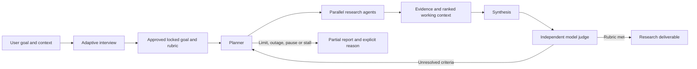

# Snowball: generic goal + runtime rubric research harness

**Status:** user-approved architecture. The user selected “Approve and build” after written-spec review. Implementation and verification remain separate.

The user rejected the master-specific evaluator and selected **Goal + runtime rubric**. The previous `2026-10-09-snowball-goal-harness-design.md` and its implementation plan are frozen historical artifacts. They are not the current build target. Existing uncommitted work is preserved; nothing in this document authorizes deployment, live personal research, applications, outreach, or starting the Oracle loop.

## 1. The tool and the goal are different things

Snowball is a research harness. It accepts an arbitrary research goal, clarifies intent, freezes an approved goal and rubric, runs research agents, manages evidence and working context, and judges progress against that rubric.

Finding funded study options is one possible runtime goal. It must not become a Python question bank, financial rule engine, database ontology, or built-in definition of success. Loan conditions, academic credentials, costs, career outcomes, and similar domain questions are reasoned about by the harness's agents when that goal calls for them.

**Code owns:** authorization, durable state, model/tool contracts, source integrity, citations, privacy boundaries, resource admission, concurrency, context bounds, and explicit controls.

**Models own:** adaptive questions, proposed goal-specific criteria, research hypotheses, relevance assessments, synthesis, and evidence-based semantic evaluation against the approved rubric.

Models do not own permission to change the goal, disclose context, exceed a limit, bypass source integrity, or call a task successful without a valid judge result.

## 2. Core loop

The goal is not rewritten at each leaf. The planner changes the strategy and next tasks. Material changes to objective, constraints, rubric, context disclosure, or success definition require a reviewed revision and explicit user approval.

## 3. Generic goal contract

Each immutable version contains:

- the user's objective and requested research deliverable;
- user-confirmed constraints and preferences, with stable identifiers;
- a runtime rubric: criterion identifiers, natural-language descriptions, required versus optional criteria, expected evidence, and explicitly accepted qualifications with stable qualification IDs;
- the approved question definitions and frozen answers/context used to clarify that version;
- answer provenance and confirmation state, including imported and unknown values;
- an independently reviewed public research brief and public rubric subset;
- recipient permissions for context classes;
- source scope and restrictions;
- approved absolute execution ceilings and stopping policy;
- any explicitly permitted monitoring work.

No required `degree_level`, `citizenship`, `intake_windows`, `tuition`, `award_type`, `max_upfront_cash`, or similar domain fields exist in the generic contract schema. A goal may introduce such information as runtime context or criteria; other goals need none of it.

Approval hashes the complete version, including question definitions, answers, provenance, visibility, and rubric. The public projection has a separate hash; it never includes the private contract hash. Draft edits cannot change an approved version. Existing CAS and actor/operation/request-hashed idempotency semantics remain.

Contract approval, a finite execution grant, and start are separate operations. Unknown context is not zero or a guessed fact. A judge can report an unknown required criterion; it cannot silently drop it.

Every answer included in an approved version must be confirmed, explicitly unknown, or declined where permitted. Unconfirmed imported candidates remain draft material and block inclusion, not facts an approval silently confirms. Public requests use an opaque version identifier and public-projection hash; code maps them to the internal binding without exposing private hashes.

## 4. Adaptive interview

A small domain-neutral opening collects the objective, deliverable, constraints, success expectations, research limits, and disclosure choices. A model then proposes follow-up questions for ambiguities or missing information that materially affect this goal.

Code renders this opening without a model call. It durably records pre-version recipient consent against the exact proposed input/context references before dispatch, with a finite interview-only call/usage allowance. Draft revision and consent identity bind these calls; changing inputs invalidates the prior authorization. This allowance permits interview model calls, not acquisition, a research grant or automatic start.

Question definitions use generic input types: text, boolean, integer, decimal, choice, list, object, or document reference. Stable question IDs, required/optional status, confirmation, and visibility are stored. There is no hardcoded master's questionnaire.

The UI and CLI render the same stored definitions. They support answering, correcting, declining optional questions, explicitly marking information unknown, and reviewing imported context without automatically confirming it. A refused disclosure remains refused; it is not silently changed to public to make proposal succeed.

The interview proposes the rubric and public brief. The user reviews their meaning, not just a hash. Generated criteria and inferred preferences remain proposals until approval. If the requested success requires an action this research harness cannot perform, the interview explains that limitation; the user decides whether to revise the deliverable. The harness never narrows the goal on its own.

Follow-up generation receives only question definitions, answer values and status metadata authorized for that recipient. A private answer's presence, refusal, provenance or question text is not implicitly public merely because the value was omitted.

## 5. Research agents and tools

The planner receives the current approved research brief, permissible rubric/context, evidence coverage, outstanding gaps, frontier, and headroom. It proposes bounded tasks targeting criterion IDs or explicit exploration questions.

Research workers operate through a restricted harness-controlled tool loop: public search, public page fetch, reading stored sources, and reading goal-scoped working context. They submit findings and follow-up hypotheses. Tool requests are validated and admitted by code; source text cannot grant new capabilities. No arbitrary shell, application submission, purchase, credential use on target sites, or outreach is available.

Reuse the existing public acquisition and access controls: SSRF pinning and denied address ranges, robots, login/paywall/access-denial handling, rate-limit cooldowns, and paid-provider activation rules. Paid fetching remains off without its separate existing authorization.

A query must originate from approved public context or public evidence. Fetch targets must be approved seeds or discovered public links. A model-provided explanation is not proof of access, relevance, or novelty.

Workers return results to the owning integration thread. No SQLite connection is shared across worker threads; no transaction spans external I/O. Independent tasks can run concurrently within the execution grant. Duplicate tasks, visited source identities, and per-domain work are accounted for durably.

A separate synthesis role assembles the proposed deliverable from authorized context and reviewed evidence. Its output records evidence references, context class, model identity and goal/version/strategy binding. It cannot change the rubric or mark the goal met; the independent judge evaluates its result.

## 6. Generic evidence, not funding packages

The active evidence model uses generic subjects/findings, immutable source snapshots, claims, criterion associations, review results, and judge results. No active `programs`, `funding_packages`, financial component registry, fixed award taxonomy, or required FX table is needed.

Each source-backed claim records the actual snapshot, exact quote offsets and hash, subject if applicable, provenance, model identity, and goal/version/task binding. Code verifies the referenced source and quote. Source applicability and dates are represented as evidenced metadata, not inferred from fetch time or a hardcoded intake parser.

An independent review can keep, dispute, reject, or leave a claim unknown. Missing, malformed, truncated, or unavailable model results never become accepted support. Verdicts bind to explicit claim IDs; positional fallback is prohibited.

Positive support uses kept claims. Rejected or unknown claims cannot support `met` or `conditional`; disputed material remains available as conflicting evidence rather than positive support. Reasoning findings resolve to their kept source-backed basis. The judge exposes unresolved material conflict instead of suppressing it. Conditional rows name a qualification ID accepted for that criterion in the locked rubric.

Semantic findings may be inferred from several sources, but retain their basis and are labelled as reasoning rather than a quoted source fact. Human notes, imported history, and legacy leads retain their provenance and cannot masquerade as independently verified public evidence.

Domain arithmetic or interpretation is not implemented as a specialist rule engine. Agents must support their reasoning with the goal's evidence and disclose assumptions. Source-checking code does not pretend to prove the reasoning merely because its quotations match.

## 7. Independent runtime rubric judge

The judge is a separate configured model role from the producing research step, with a fresh context assembled from authorized inputs and evidence rather than the producer's conversation history. A judge authorized for the full rubric and deliverable receives the exact locked rubric. A public-only judge receives its approved public subset and can assess that subset only. Full rubric-met requires authorized assessments of every required criterion and the actual deliverable; missing private assessment stays unknown with the recipient prerequisite exposed.

Each structured result covers every required criterion in that call's authorized rubric scope by ID:

- `met`, `unmet`, `unknown`, `conditional`, or `contested`;
- a reason and supporting or conflicting evidence references;
- missing evidence and proposed next research questions;
- assessment of whether the requested research deliverable is supported.

Code rejects unknown or duplicate criterion IDs, missing required rows within the authorized scope, invalid citations, unauthorized context, stale bindings, and malformed/truncated results. Positive or conditional support needs valid kept evidence references; absence of support is `unknown`, not an invented negative fact. A required `conditional` criterion counts only if its qualification ID was explicitly accepted in the locked rubric. `unknown`, `unmet`, or `contested` required criteria prevent a rubric-met outcome.

No code branch decides that a loan, GPA, scholarship, software feature, or medical claim satisfies a particular goal. Those meanings belong to runtime rubric assessment. Code validates that the result actually addresses the approved criteria and cites available evidence.

Rubric met means the approved **research deliverable** is supported. It does not assert that external outcomes have occurred. Budget exhaustion, empty frontier, outages, or an unchanged strategy produce an honest partial/blocked outcome, never success.

Model judgments can be wrong even with real citations. The harness exposes reasoning, conflicts and sources for inspection; it does not advertise semantic certainty. This is the deliberate tradeoff of a goal-agnostic model judge instead of a domain expert system.

The judge may recommend further research or a partial report under the approved stopping policy. A source-supported negative finding can rule out a candidate or support a scoped negative report; it does not prove universal impossibility or automatically end research on other candidates. Partial results distinguish evidenced negatives from missing evidence.

## 8. Ranked working context and periodic refresh

Persist all acquired evidence and decisions in the audit store. Working context is a bounded selection, not the entire crawl history.

Agents and the judge provide goal-specific relevance and support assessments linked to existing evidence IDs. Code validates the references, applies the configured item/token bounds, and assembles context with coverage of outstanding criteria. Low-scoring material can leave working context without being deleted from the source/audit store. Conflicting or missing support remains visible even if its relevance score is low.

Refresh working context at a configurable cadence, proposed as every ten committed researcher model turns, and at judge/strategy checkpoints. A turn is one current-binding model response accepted by the owning thread, whether it requests a tool or submits a finding. The per-goal/version counter is durable; stale responses do not advance it. A due refresh applies before the next researcher turn, not by injecting into an in-flight request. Refresh uses the current evidence and gaps; any additional search or model call needs its own admission. It is not an unbounded cron, a private parent-chat injection, or permission to continue while paused or exhausted.

A refresh advances a context-selection version recorded on subsequent calls. It does not revoke otherwise-current in-flight tasks. Their responses retain the dispatched context version as provenance and still pass current contract/strategy/epoch and evidence checks.

Node expansion depends on approved criterion gaps, evidence uncertainty, relevance, source quality, expected cost, and remaining limits. A recorded model assessment can inform priority; code still enforces scope, leases, due/access checks, and ceilings. The activity view explains selected and deferred work.

Use durable query/source identities and work/evidence/criterion fingerprints to detect repeated work and stalls. Novel phrasing is not evidence progress.

## 9. Privacy and model routing

All context is labelled and recipient-scoped. Private answers and documents stay private by default. Public models receive only the user-approved public brief/rubric and public sources, not a summary synthesized from unapproved private inputs.

Private interview or evaluation uses an attested isolated local model, or a cloud recipient only when the user explicitly approves that recipient and context for that goal. No new cloud-private permission is inferred from this design approval. If no authorized recipient is available, expose the missing prerequisite and retain unknown status; do not silently fall back.

Before an adaptive interview calls a cloud model, the opening obtains explicit permission for the initial objective/context it would send. An approved public objective can generate questions about missing context without exposing the private answers. A wholly private objective needs an authorized private recipient. There is no dependency on an already completed public-brief approval to obtain this initial permission.

Derived outputs inherit the union of their inputs' disclosure restrictions; code cannot treat model rewriting as declassification. Search services and fetch targets are recipients too. Public-only research calls produce queries and URLs from authorized public inputs/evidence; a free-text explanation is not provenance. Sending private-derived material requires an explicit review and approval of the exact disclosure artifact for that recipient. This rule also covers proposed public briefs and deliverables.

Code checks typed provenance and approved projection identity, not coincidence between public numbers and private values. Bootstrap credentials, model credentials, private context, and private contract hashes are not logged or included in public requests.

Opaque CLI memory, inherited rules/history, extensions, or hidden session context invalidate a claimed public-only boundary unless isolation is actually established. Prefer explicit request payloads for runtime model adapters. No silent model/provider substitution.

Record requested/reported model, role, prompt version, context/source references, transport, and actual/estimated/unknown usage per call. Reasoning usage is retained when supplied. Estimated proxy counters are not a provider invoice guarantee. Independent Claude verification of the build uses generic source and fixtures, not the applicant's actual profile.

An explicitly reported model/provider mismatch rejects the semantic result, records the event and charges attributable usage, or conservative lost usage when unavailable. No accepted result is relabelled as the requested model. An unverified identity remains recorded as unknown and cannot satisfy a recipient/identity requirement needing attestation.

All cloud build, advisor and review workers receive allowlisted generic source and synthetic fixtures only. Their source-only working copies exclude real databases, private documents/history, wiki content, rollback bundles, credentials and personal-goal artifacts. The parent owns real-data integration and migration verification; Claude has no special exemption.

## 10. Durable controls and limits

Retain the reusable control-plane machinery: immutable versions, separate finite grants, exact goal/contract/strategy/epoch binding, task occurrences, atomic bundled reservations, domain leases, conservative lost usage, replacement-grant lifetime accounting, and authenticated controls.

Admission checks settled, reserved and lost version-lifetime usage across all grants against the approved absolute ceilings. Replacement grants may reallocate unused allowance but cannot reset lifetime charges or raise those ceilings without an approved revision; nominal historical grant allocations are not summed as if all were spent.

Limits name their units: admitted expansion tasks, acquired sources/bytes, model/tool calls, model usage, elapsed time and concurrent work. Ranked-context item/token bounds and graph display bounds are separate. Admission enforces the configured finite ceilings; adding graph nodes or rephrasing a task cannot disguise new research work.

Validate every dispatch result; a failed admission/fence means no external call. Owner commits check the binding in their transaction. Late results preserve raw evidence and attributable usage but cannot update the current goal's findings, active source state, or judge results.

Pause stops new admission and truthfully exposes draining work. Cancelled undispatched operations release resources through the canonical ledger lifecycle, including shared identity accounting. Dispatched uncertainty stays charged. Revision cancellation never resumes research automatically. STOP and interrupts stop the process without rewriting the user's goal.

Pause or grant renewal does not erase already completed judgments for the same contract and still-current evidence. Revoked dispatch bindings forbid new late commits; they do not retroactively turn completed work into an outage. A reviewed goal revision or genuinely superseded evidence is handled explicitly.

An approved goal revision revokes old admission, retires its grant and fences in-flight semantic commits; it never starts the replacement version. Criterion IDs can persist only with unchanged definitions; every version retains its own rubric binding. Reusing old evidence requires authorized reassociation/review under the new version, not carrying over a success verdict.

Judgments bind to the rubric version and a fingerprint of their cited claims, source snapshots and review states. A changed or newly disputed/superseded dependency invalidates its dependent assessment and any resulting rubric-met outcome until reassessment. Unrelated evidence additions do not revoke completed judgments.

Persist explicit outcomes: progressing, rubric met, partial coverage, blocked, outage, exhausted, empty frontier, stalled, or user stopped. The goal's substantive success definition is not inferred from those operational tokens.

Monitoring requires an explicit monitoring grant and approved refresh scope. It cannot restart broad acquisition after completion.

## 11. CLI and console

Keep the authenticated five-view console, with generic names and data: **Goal, Results, Activity, Evidence, Graph**. Graph remains last. Reuse the approved visual tokens, keyboard model, responsive layout, reduced-motion/focus behavior, and safe source rendering.

Goal displays the objective, adaptive interview, rubric/public-brief review, recipient permissions, grant, and explicit controls. Results displays the actual supported deliverable and generic criterion assessments. Activity shows task/agent decisions, refresh checkpoints, budgets and drain/outage state. Evidence shows exact source excerpts and review basis. No fabricated demonstration rows.

Remove embedded master's question definitions and hardcoded financial matrices. The API and CLI consume stored generic question/rubric definitions. Preserve structured errors, CAS conflicts without blind retries, actor-scoped idempotency, one-use bootstrap/session/CSRF protection, independent Origin checks, loopback binding, and existing strict security headers.

The app must accept an unrelated research goal without schema/code changes. A master's example belongs only to runtime input or an isolated scenario.

## 12. Cutover and data preservation

Keep the existing worktree; do not delete or overwrite unrelated user changes. The old specification, review outputs, and unverified implementation are historical evidence of the scope mistake, not acceptance evidence for this harness.

Replace domain-specific consumers together: interview, goal proposal validation, prompts, planner coverage, qualification/judging, schema, console/API/UI, CLI, supervisor, wiki/ask, diagnostics, configuration, and docs. No obsolete finance aliases, duplicate frame types, or compatibility paths remain in active code.

Reuse source-backed infrastructure only after actual current-state verification. Source review alone did not establish that the old migration, ledger, console, or runtime passes. Known generic issues such as lexical path guards, wiki-relative identifiers on backup/restore, cancellation accounting, and dispatch/commit fencing remain requirements.

Use an explicit generic schema version and ordered migration. Preserve existing v2/v3 lead data and any locally created previous v4 goals/evidence in a checksummed DB/source/wiki rollback bundle. Previous specialist contract versions are retained as historical records; they are not silently converted into an approved generic rubric or granted execution. The user must review a new generic contract before it runs. Read-only commands never migrate.

Never remap logical wiki-relative page identifiers into absolute keys. Check filesystem paths lexically before resolving symlinks/reparse points, and restore the full corpus atomically into an isolated root.

## 13. Replacement implementation phases

These are design boundaries, not completed tasks or an executable implementation plan:

1. Generic contract/question/rubric schema and explicit preserving migration.
2. Adaptive interview, public-brief review, generic goal CLI and approval controls.
3. Typed generic model/tool adapters and recipient/usage enforcement.
4. Bounded parallel research loop with atomic admission and stale-result fencing.
5. Generic claims, evidence review, semantic rubric judge and supported deliverable.
6. Ranked working context, periodic refresh, priority and stall detection.
7. Complete authenticated generic control/read API.
8. Generic five-view frontend and actual desktop/mobile/keyboard verification.
9. Supervisor, diagnostics, wiki/ask, retention and safe operator integration.
10. Full CLI/API/browser/model scenario proof, independent Claude review, docs and verified commits.

Write the detailed replacement plan only after the user reviews this specification. Keep Grok build slices disjoint or isolated, with one integration owner. Use Gemini as a sanitized advisor/judge and source researcher at checkpoints. Parallel read-only reviews can overlap writers; overlapping writers cannot share files. Respect the 32-concurrent agent cap and queue excess.

## 14. Acceptance

- Two unrelated research goals run through the same interview, schema, planner, tools, context manager and judge without adding domain fields or changing code. At least one is a non-funding goal.
- The interview actually asks follow-up questions, permits unknown/declined optional context, and obtains reviewed goal/rubric/public-brief approval without imported auto-confirmation.
- Changing the goal requires approval; a leaf or judge cannot rewrite it. Approval never implicitly grants or starts execution.
- A bounded real model/tool scenario shows evidence acquisition, supported claims, ranked context, an independent criterion judge, and the recorded next task or rubric-met decision. Synthetic fixtures and live sources are distinguished.
- Missing citation, conflicting support, malformed/truncated judge output, unavailable roles, stale callbacks, and unauthorized context produce honest non-success outcomes.
- Context refresh occurs at its configured cadence; high-utility support stays, low-utility material leaves working context but remains retrievable. Paused or exhausted goals make zero new external calls.
- Node/tool/model counters survive parallel admissions, retries, restart, pause and replacement grants. Ambiguous dispatched work is charged; actual model identity/usage is not fabricated.
- Actual CLI/API and browser flows cover interview, review/approval, separate grant/start, pause/drain, revision, results/evidence, empty/blocked graph, and keyboard/mobile behavior.
- Same-server auth, CSRF/Origin/framing/CAS/idempotency/privacy checks and complete migration/rollback are exercised; current-state tests and smoke proof precede completion claims.
- Negative egress scenarios prove private values and private-derived outputs do not reach unauthorized model, search or fetch recipients. First-cloud-call consent and imported-answer confirmation are exercised.
- Mid-run revision fences old results and requires separate grant/start. Superseding or disputing cited support invalidates dependent success; an unrelated evidence addition does not.
- An evidenced-negative scenario produces a scoped partial result or justified alternative task without inventing success or repeating exhausted work.
- No master-specific financial evaluator or fixed credential question bank remains in active code. Master's research, when separately authorized, is a runtime end-to-end goal—not manually performed by the build assistant instead of by Snowball.
- Oracle AGY/tailnet wiring and git/README delivery remain required. Installing the tool does not authorize personal research; a live personal run needs its actual approved goal, recipient permissions and bounded grant.

## 15. Current evidence and next decision

The user selected the generic runtime-rubric approach and approved this written architecture. Owned obsolete live builders/reviewers were cancelled; remaining registry-only writers confirmed no tool was writing and no edit was mid-transaction. Existing code was preserved. The requested isolated Claude Fable 5.1 design review returned concrete feedback, incorporated here. No generic implementation, integrated passing suite, frontend smoke, deployment, or research-result success is claimed.

**Next action:** replace the frozen task plan and implement/test this generic harness. Architecture approval does not authorize sending the actual applicant profile to cloud research roles or starting a live personal run.
